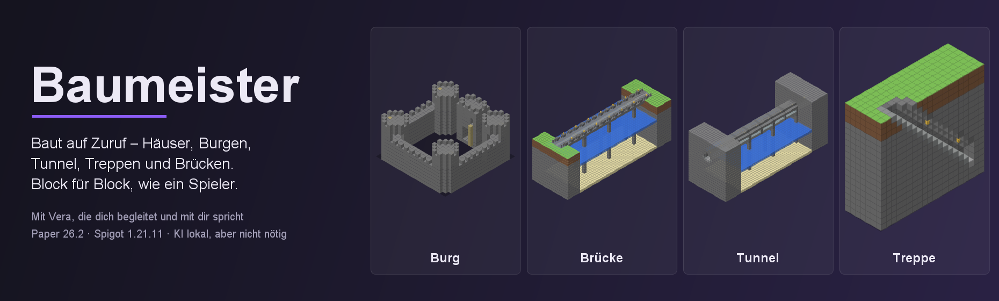
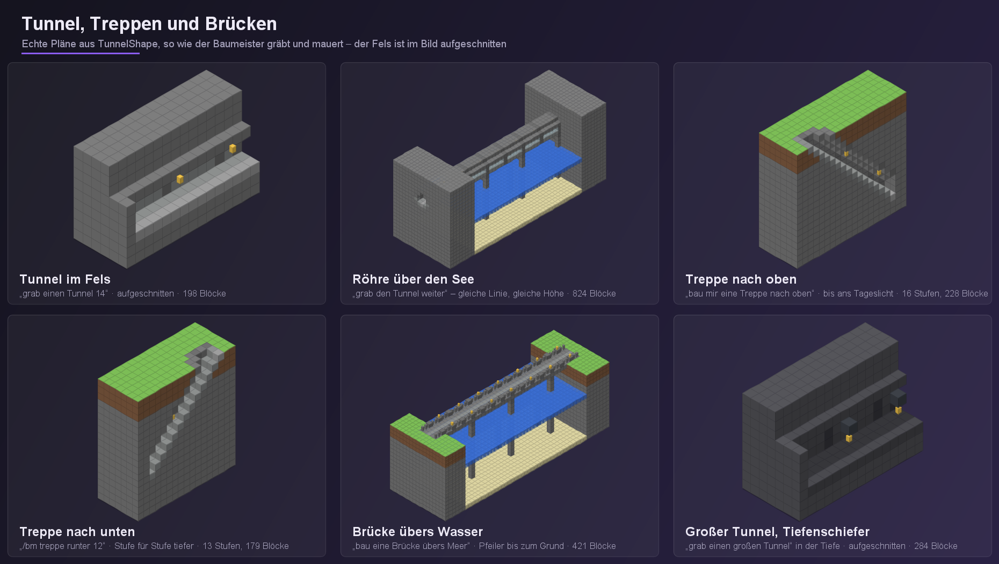
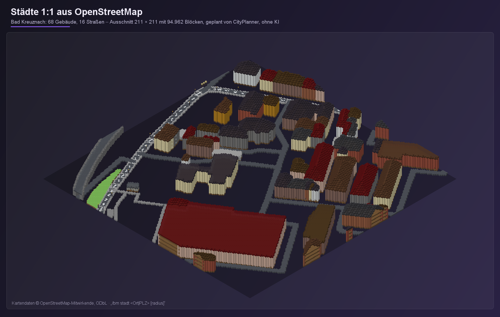

<div align="center">



**Ein Minecraft-Plugin mit einem Baumeister, der auf Zuruf baut – Häuser, Burgen, Tunnel, Treppen und Brücken,
Block für Block wie ein Spieler – und mit Vera, einer Begleiterin, die mit dir spricht.**


[Wo anfangen](#wo-fange-ich-an) · [Was es kann](#was-es-kann) ·
[Tunnel, Treppen, Brücken](docs/spielen.md#tunnel-treppen-und-brücken) ·
[Was geht, was noch nicht](#was-geht-was-noch-nicht) · [So funktioniert's](#so-funktionierts) · [Loslegen](#loslegen) ·
[Befehle](#die-wichtigsten-befehle) · [Für Entwickler](#für-entwickler) · [Mitmachen](#mitmachen)

</div>

## Wo fange ich an?

| Du willst … | Dann lies |
|---|---|
| **spielen** – den Baumeister bauen lassen, mit Vera reden | [Spielen mit dem Baumeister](docs/spielen.md) |
| **einen Server betreiben** – Plugin, KI, Rechte, Stimme einrichten | [Installation](docs/installation.md), dann das [Handbuch](docs/handbuch.md) |
| **mitentwickeln** – Aufbau verstehen, bauen, testen | [Entwicklung](docs/entwicklung.md) und [Mitmachen](CONTRIBUTING.md) |

Alle Dokumente auf einen Blick: [docs/](docs/README.md).

## Was es kann

- **Bauen auf Zuruf.** „Baumeister, bau mir ein kleines Haus aus Fichtenholz“ – eine lokale KI plant, das Plugin
  prüft jeden Block, und der NPC setzt ihn sichtbar. Vorschau, Rückgängig und Warteschlange inklusive.
- **Schnellbau ohne KI.** Pyramide, Burg, Hochhaus, Bogenbrücke, Garten, Bäume, Farmen, Bunker, Lobby – sofort, auch
  wenn keine KI läuft.
- **Tunnel, Treppen und Brücken.** „Grab mit mir einen Tunnel“: Er gräbt vor dir her, ausgemauert und mit Laternen,
  schnurgerade bis 10 000 Blöcke, über Täler und Seen als Röhre. Treppen hinauf und hinab, Brücken mit Pfeilern bis
  zum Grund. Was er abgräbt, steht in vollen Fässern in der Tunnelwand.
- **Schematics.** `.schem`, `.schematic` (auch vor 1.13), `.litematic` und `.nbt` ohne WorldEdit, bis 1 Mio. Blöcke –
  im Katalog zum Durchklicken.
- **Maschinen und Logik.** Geprüfte Redstone-Maschinen in vier Richtungen und Schaltungen direkt aus einer Formel
  (`Q = A und (B oder nicht C)`).
- **Vera, die Begleiterin.** Folgt dir, findet Erze und Dörfer, prüft und repariert Schaltungen, führt durch ein
  Abenteuer bis zum Enderdrachen – und spricht im Voice Chat mit eigener Stimme.
- **Die Welt 1:1.** Gelände, Städte und ganze Erdkacheln aus Höhendaten und OpenStreetMap.
- **Für alle Spieler.** Hilfebuch zum Anklicken, Rucksack mit Teamkisten, Warps, Tagesaufgaben, Mods-Download.
- **Nichts geht verloren.** Rückgängig für die letzten 50 Bauten, auch nach einem Neustart.




<table>
<tr>
<td width="60%"></td>
<td width="40%"></td>
</tr>
<tr>
<td><b>Hilfebuch</b> – jede Zeile ein Knopf, Kapitel nur mit Recht.</td>
<td><b>Katalog</b> – Hunderte Schematics, ein Klick baut.</td>
</tr>
</table>




<sub>Alle Bilder zeichnet [`ReadmeBilder`](src/test/java/com/blackn0va/baumeister/bilder/ReadmeBilder.java) aus dem
echten Plugin-Code – dieselben Pläne, die der Baumeister baut, ohne Spiel-Texturen.</sub>

## Was geht, was noch nicht

Stand 2026-11-19. ✅ läuft – im Spiel benutzt oder auf beiden Testservern (Paper 26.2, Spigot 1.21.11) Ende zu Ende
geprüft · 🧪 mit einem echten Spieler im Spiel noch nicht gesehen – nur per Test oder ohne Spieler über die Konsole
geprüft · ⚠️ läuft mit Grenzen · ❌ geht nicht

| Bereich | Was geht | Was noch nicht |
|---|---|---|
| **Bauen per KI** | ✅ Aufträge per `/bm bau`: die KI plant, das Plugin prüft jeden Block, der NPC baut | 🧪 derselbe Auftrag im Chat („Baumeister, …“) von einem echten Spieler · ⚠️ freie Entwürfe (Brunnen, Turmdetails) mit dem 7B-Modell schwankend, Häuser gelingen |
| **Schnellbau ohne KI** | ✅ Pyramide, Burg (ab Hofseite 9 mit Weg und Brunnen), Hochhaus, Bogenbrücke (mit Rampen an beiden Enden), Garten, Bäume, Farmen, Bunker, Lobby, Portalhalle | 🧪 Mauer und Baum noch nicht im Spiel gebaut · Burghof und Brückenrampen nur per Test, nicht im Spiel |
| **Tunnel, Treppen, Brücken** | ✅ Tunnel bis 10 000 Blöcke, Röhre über Täler und Seen, Treppe hinauf und hinab, Brücke, Weiterbauen, „stopp“ – auf beiden Testservern; Tunnel, Treppe nach oben und Brücke auch im Spiel | 🧪 mit einem echten Spieler: Mitgraben ohne Ende, Treppe aus dem Gang heraus, Fässer aus der Kiste bezahlt |
| **Maschinen und Logik** | ✅ 28 Maschinen in vier Richtungen (112/112), neu: Akkumulator mit Löschen und Item-Sortierer für 2–8 Sorten (Spigot 4/4), 16 Formeln in vier Richtungen (64/64), Logik in Stockwerken in vier Richtungen (24/24, bis 16 Lampen) | ⚠️ Logik bis 5 Eingänge, Ausgänge nicht beschildert |
| **Farmen** | ✅ acht Farmen ohne KI, je in vier Richtungen geprüft, mit Bedienhinweisen | 🧪 Ertrag über Stunden (Golems, Kaktus) nicht im Spiel gemessen |
| **Schematics** | ✅ alle vier Formate, Katalog, 804 Bauten aus dem Technik Wiki | ⚠️ ob jede ausgeschnittene Schaltung wie im Original funktioniert, ist nicht gemessen |
| **Vera** | ✅ folgen, Wege finden, reden (auch ohne KI für die meisten Sätze), Stimme, Schaltungen prüfen und reparieren, Abenteuer | 🧪 Ortssuche (Dorf, Festung) und Erze im Tiefenschiefer nur per Test · ein eigener Begleitername geht jetzt in die Spracherkennung, ob er dadurch besser erkannt wird, ist nicht gemessen |
| **Stadtleben** (Bewohner mit KI) | 🧪 Spigot und Paper 26.2 belegt: bis 12 Bewohner mit Tagesablauf, Grüßen und KI-Gespräch, gehen binnen Sekunden, wenn die KI ausfällt, unter 0,2 ms je Tick | 🧪 dev01 (Celeron) nicht geprüft · mit echtem Spieler nur per Probe-Client · Arbeitsorte sind Plätze nahe der Wohnung, keine Gebäude |
| **Welt 1:1** | ✅ Städte aus OpenStreetMap, Gelände auf den Meter, Erdwelt mit Wasser | ⚠️ Städte stehen auf flachem Boden, Bahnbrücken liegen flach · 🧪 Reisen und Weltbau-Automatik nur über die Konsole geprüft |
| **Rückgängig** | ✅ 50 Bauten zurück, über Neustarts hinweg, Herausfallen im Log; Wiederherstellen beim Start für Betreiber | ⚠️ der Weltbau überlebt keinen Neustart · ein Bau aus der Kiste ist bewusst nicht rückgängig |
| **Rechte und Schutz** | ✅ jeder Block im Namen des Spielers geprüft (Stufen, Grundstücke), fail-closed | 🧪 gegen WorldGuard und PlotSquared nur im Code und per Test, nicht mit echtem Spieler |
| **Komfort** | ✅ Warteschlange, Helfer | 🧪 Vorschau (Partikel, „ja“/„nein“) und Fortschrittsbalken mit einem echten Spieler |
| **Baumeister-Host** (KI auf dem GPU-PC) | ✅ Vulkan auf Intel Arc gemessen, Verbindung über TLS mit gepinnten Zertifikaten | ⚠️ NVIDIA/CUDA mit 14B nicht in jedem Lauf geprüft · eigenes Modell: Training steht aus |
| **Client-Mod** (Fabric) | ✅ Minecraft 26.2, im echten Client geprüft · Nachträge mit Gedächtnis („mach das Dach rot“), KI-Werte geprüft | 🧪 Nachtrag und Rückgängig des Nachtrags nur per Test, nicht im echten Spiel |

Jede Zeile hat ihren Beleg im [Prüfprotokoll des Handbuchs](docs/handbuch.md#stand). Tests heute: Plugin 1 674
Unit-Tests grün (2026-11-17), Relay 155 grün (2026-11-21, alle Fristen und Budgets mit eigenem Test), Host 14 Testprogramme.

## So funktioniert's


Die KI liefert nur einen Bauplan in einem festen Schema. Was gebaut wird, entscheidet das Plugin: Es prüft jeden
Block gegen die Rechte des Spielers (WorldGuard, PlotSquared, eigene Stufen) und setzt nichts, was der Spieler nicht
selbst setzen dürfte. Ohne KI laufen Schnellbau, Tunnel, Schematics, Maschinen und der größte Teil von Vera weiter.


## Loslegen

1. **Plugin:** `Baumeister-<fassung>.jar` nach `plugins/`, Server starten.
2. **KI (optional):** ein OpenAI-kompatibler Server – `llama-server`, Ollama oder der Baumeister-Host auf einem
   GPU-PC. Adresse und Modell stehen in `config.yml` unter `llm.url` und `llm.modell`.
3. **Im Spiel:** Hilfebuch öffnen (`/hilfe`) oder im Chat „Baumeister, bau mir eine Burg“.

Ausführlich – drei Ausbaustufen, Rechte, Mods für Spieler, Stimme: [docs/installation.md](docs/installation.md).
Alles in einem Paket: `pwsh -File tools\paket\Paket-Erstellen.ps1`.

## Die wichtigsten Befehle

| Befehl | Was passiert |
|---|---|
| `Baumeister, bau mir …` im Chat · `/bm bau <auftrag>` | planen und bauen |
| `/bm vorschau <auftrag>` · `/bm rückgängig` · `/bm stop` | Umriss zeigen · zurückbauen (50 Bauten) · anhalten |
| `/bm katalog [suchwort]` | Schematics durchklicken und bauen |
| `/bm logik Q = A und B` | Redstone-Schaltung aus einer Formel |
| `Baumeister, grab mit mir einen Tunnel` · `/bm tunnel` · `/bm treppe` · `/bm treppe runter` · `/bm brücke` | Tunnel, Treppe nach oben und unten, Brücke – mitbauen oder im Schnellgang |
| `/vera` · `Vera, wo finde ich Diamanten?` | Begleiterin rufen und fragen |
| `/hilfe` | Hilfebuch – alles per Klick |
| `/rucksack` · `/warp` · `/aufgaben` · `/mods` | Rucksack, Warps, Tagesaufgaben, Mods |
| `/bm status` | Zustand, KI erreichbar?, wie viele Bauten rückgängig machbar |

Alle Befehle und Rechte: [Handbuch → Befehle](docs/handbuch.md#befehle).

## Für Entwickler

| Ordner | Inhalt |
|---|---|
| [`src/`](src) | Plugin (Java 21, Maven) – Einstieg: [`BaumeisterPlugin`](src/main/java/com/blackn0va/baumeister/BaumeisterPlugin.java) |
| [`host/`](host) | Baumeister-Host für den GPU-PC (C++20, Qt 6, llama.cpp) – [README](host/README.md) |
| [`relay/`](relay) | Relay für die Verbindung Host ↔ Server über TLS mit gepinnten Zertifikaten – [Einrichtung](relay/deploy/README.md) |
| [`client/`](client) | Fabric-Mod: der Baumeister baut mit deiner eigenen Spielfigur, auch ohne Server-Plugin – [README](client/README.md) |
| [`probes/`](probes) | Messproben: kleine Programme, die eine Frage am echten Verhalten klären |
| [`tools/`](tools) | Paket, Modpaket, Kanal-Testvektoren, Training eines eigenen Modells |
| [`docs/`](docs) | [Spielen](docs/spielen.md), [Handbuch](docs/handbuch.md), [Installation](docs/installation.md), [Entwicklung](docs/entwicklung.md) und mehr |

```bash
mvn package                      # Plugin samt Tests → target/Baumeister-<fassung>.jar
mvn -f relay/pom.xml package     # Relay samt Tests
pwsh -File host/build.ps1        # Host (Windows, MSVC) samt Tests und Setup
```

Die Server-APIs zum Kompilieren stehen nicht im Repo – woher sie kommen: [`lib/README.md`](lib/README.md). Wie das
Plugin aufgebaut ist, wo man anfängt zu lesen und wie getestet wird: [docs/entwicklung.md](docs/entwicklung.md).

## Mitmachen

Beiträge sind willkommen – neue Schnellbauten, Maschinen, Übersetzungen, Fehlerberichte. Fork, Branch, Pull
Request; jeder Pull Request wird vor dem Mergen von Hand geprüft und freigegeben. Wie das geht und worauf es ankommt:
[CONTRIBUTING.md](CONTRIBUTING.md). Sicherheitslücken bitte nicht als Issue, sondern wie in
[SECURITY.md](SECURITY.md) beschrieben.

## Lizenz

[GPL-3.0-or-later](LICENSE) – nutzen, ändern und weitergeben ist erlaubt, Änderungen bleiben unter derselben Lizenz
offen. Fremde Bestandteile und ihre Lizenzen: [THIRD-PARTY-NOTICES.md](THIRD-PARTY-NOTICES.md),
[host/THIRD-PARTY-NOTICES.md](host/THIRD-PARTY-NOTICES.md). Minecraft ist eine Marke von Mojang; dieses Projekt ist
nicht von Mojang oder Microsoft.
