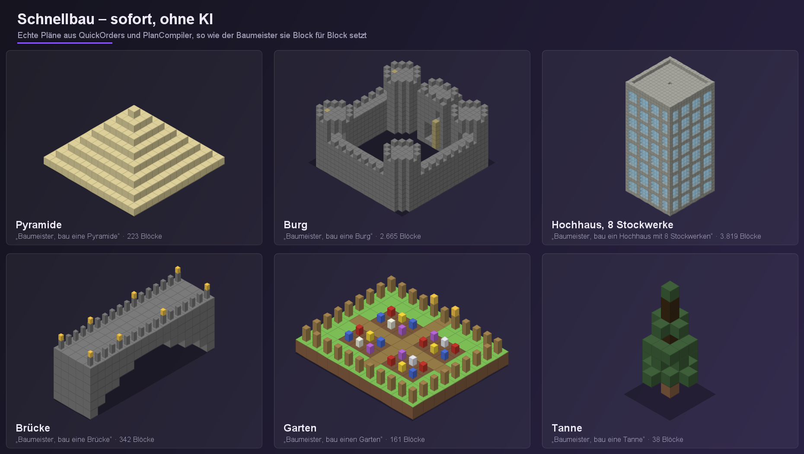
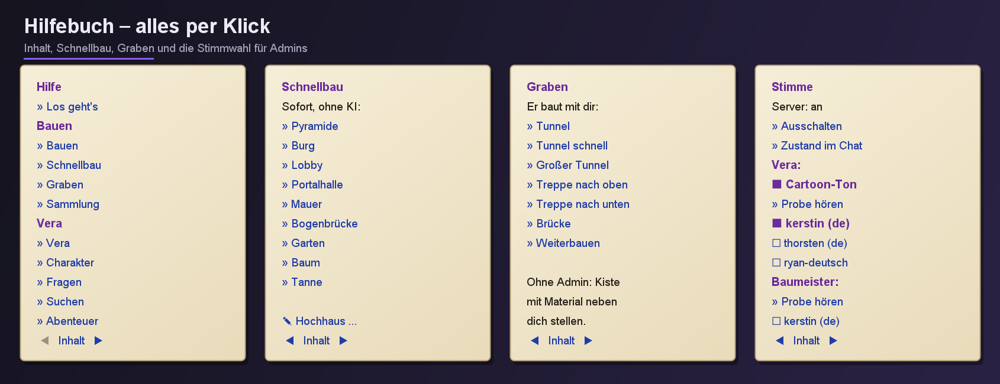
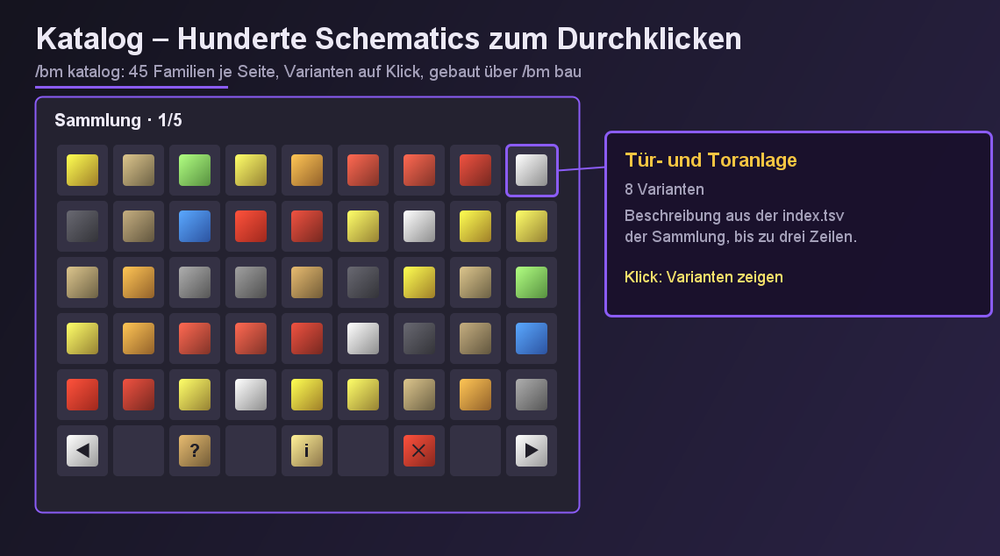
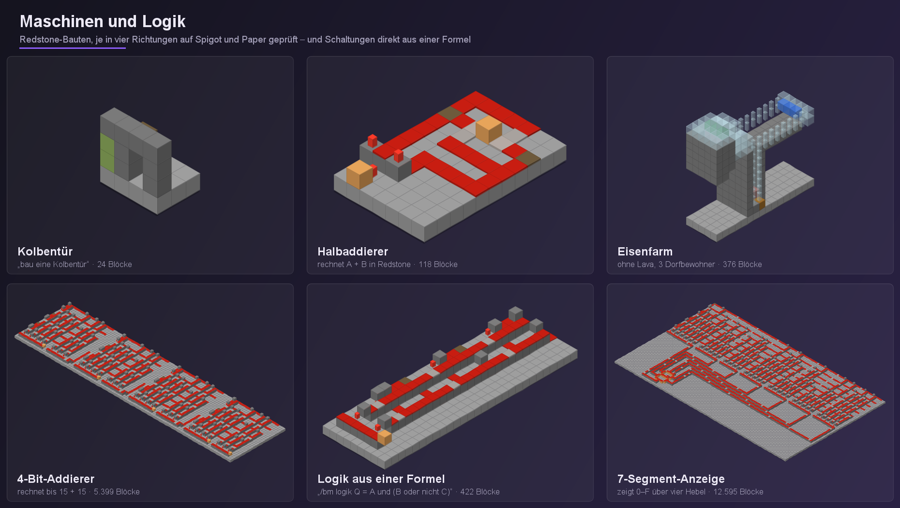
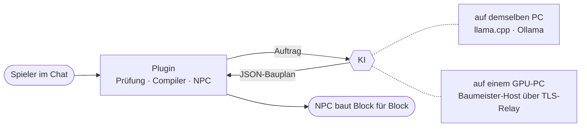
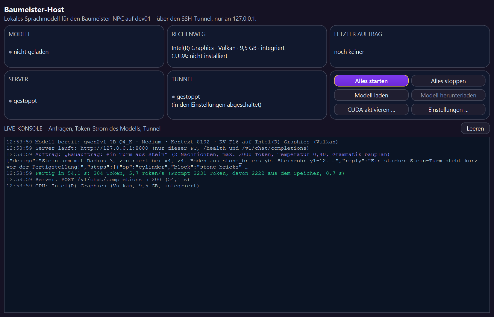

<div align="center">

# Baumeister

**Ein Minecraft-Plugin mit einem Baumeister, der auf Zuruf baut – Block für Block, wie ein Spieler –
und mit Vera, einer Begleiterin, die mit dir spricht.**


[Was es kann](#was-es-kann) · [So funktioniert's](#so-funktionierts) · [Loslegen](#loslegen) ·
[Befehle](#die-wichtigsten-befehle) · [Projekt](#projekt) · [Mitmachen](#mitmachen) · [Stand](#stand) ·
[Handbuch](docs/handbuch.md)

</div>



## Was es kann

- **Bauen auf Zuruf.** „Baumeister, bau mir ein kleines Haus aus Fichtenholz“ – eine lokale KI plant, das Plugin
  prüft jeden Block und der NPC setzt ihn sichtbar. Vorschau, Rückgängig und Warteschlange inklusive.
- **Schnellbau ohne KI.** Pyramide, Burg, Mauer, Brücke, Garten, Bäume, Hochhäuser, Farmen, Bunker – sofort, auch
  wenn keine KI läuft.
- **Schematics.** `.schem`, `.schematic` (auch vor 1.13), `.litematic` und `.nbt` ohne WorldEdit lesen und bauen,
  bis 1 Mio. Blöcke. Ein Kistenfenster zum Durchklicken.
- **Maschinen und Logik.** Geprüfte Redstone-Maschinen in vier Richtungen und Schaltungen direkt aus einer Formel
  (`Q = A und (B oder nicht C)`).
- **Tunnel, Treppen und Brücken.** „Grab mit mir einen Tunnel“ – der Baumeister gräbt vor dir her, solange du
  mitgehst, ausgemauert und mit Laternen statt Fackeln; auf Wunsch im Schnellgang. Schnurgerade quer über die Karte:
  über Täler und Meere als Röhre mit Fenstern, bis 10 000 Blöcke am Stück. Treppe bis zur Oberfläche, Brücke übers
  Meer mit Pfeilern bis zum Grund. Vorhandenes erkennt er und baut es in seiner Richtung weiter; wer kein Admin ist,
  gibt das Material aus einer Kiste.
- **Vera, die Begleiterin.** Folgt dir, findet Erze und Dörfer, führt durch ein Abenteuer bis zum Enderdrachen,
  repariert, erzählt Witze – und spricht im Voice Chat mit eigener Cartoon-Stimme, gerechnet auf dem Server.
- **Die Welt 1:1.** Gelände, Städte und ganze Erdkacheln aus Höhendaten und OpenStreetMap.
- **Für alle Spieler.** Hilfebuch zum Anklicken, Rucksack mit Teamkisten, Warps, Tagesaufgaben, Mods-Download.

<table>
<tr>
<td width="60%"></td>
<td width="40%"></td>
</tr>
<tr>
<td><b>Hilfebuch</b> – jede Zeile ein Knopf, Kapitel nur mit Recht.</td>
<td><b>Katalog</b> – Hunderte Schematics, Klick baut.</td>
</tr>
</table>




## So funktioniert's



Die KI liefert nur einen Bauplan in einem festen Schema. Was gebaut wird, entscheidet das Plugin: Es prüft jeden
Block gegen die Rechte des Spielers (WorldGuard, PlotSquared, eigene Stufen) und setzt nichts, was der Spieler nicht
selbst setzen dürfte. Ohne KI laufen alle Schnellaufträge, Schematics, Maschinen und Vera weiter.



## Loslegen

1. **Plugin:** `Baumeister-<fassung>.jar` nach `plugins/`, Server starten.
2. **KI (optional):** ein OpenAI-kompatibler Server – `llama-server`, Ollama oder der Baumeister-Host auf einem
   GPU-PC. Adresse und Modell stehen in `config.yml` unter `llm.url` und `llm.modell`.
3. **Im Spiel:** Hilfebuch öffnen (`/hilfe`) oder im Chat „Baumeister, bau mir eine Burg“.

Ausführlich – drei Ausbaustufen, Rechte, Mods für Spieler, Stimme: [docs/installation.md](docs/installation.md).
Alles in einem Paket: `pwsh -File tools\paket\Paket-Erstellen.ps1`.

## Die wichtigsten Befehle

| Befehl | Was passiert |
|---|---|
| `Baumeister, bau mir …` im Chat · `/bm bau <auftrag>` | planen und bauen |
| `/bm vorschau <auftrag>` · `/bm rückgängig` · `/bm stop` | Umriss zeigen · zurückbauen · anhalten |
| `/bm katalog [suchwort]` | Schematics durchklicken und bauen |
| `/bm logik Q = A und B` | Redstone-Schaltung aus einer Formel |
| `Baumeister, grab mit mir einen Tunnel` · `/bm tunnel` · `/bm treppe` · `/bm brücke` | Tunnel, Treppe nach oben, Brücke – mitbauen oder im Schnellgang |
| `/vera` · `Vera, wo finde ich Diamanten?` | Begleiterin rufen und fragen |
| `/hilfe` | Hilfebuch – alles per Klick |
| `/rucksack` · `/warp` · `/aufgaben` · `/mods` | Rucksack, Warps, Tagesaufgaben, Mods |
| `/bm sprache` (Admin) | Stimmen wählen, Cartoon-Ton, Probe hören |

Alle Befehle und Rechte: [Handbuch → Befehle](docs/handbuch.md#befehle).

## Projekt

| Ordner | Inhalt |
|---|---|
| [`src/`](src) | Plugin (Java 21, Maven) |
| [`host/`](host) | Baumeister-Host für den GPU-PC (C++20, Qt 6, llama.cpp) |
| [`relay/`](relay) | Relay für die Verbindung Host ↔ Server über TLS mit gepinnten Zertifikaten |
| [`client/`](client) | Fabric-Mod: der Baumeister baut mit deiner eigenen Spielfigur, auch ohne Server-Plugin |
| [`docs/`](docs) | [Handbuch](docs/handbuch.md), [Installation](docs/installation.md), [Schematics](docs/schematics.md), [Fernverbindung](docs/fernverbindung.md) |

```bash
mvn package                      # Plugin samt Tests → target/Baumeister-<fassung>.jar
pwsh -File host/build.ps1        # Host (Windows, MSVC) samt Tests und Setup
```

Die Server-APIs zum Kompilieren stehen nicht im Repo – woher sie kommen: [`lib/README.md`](lib/README.md).

## Mitmachen

Beiträge sind willkommen – neue Schnellbauten, Maschinen, Übersetzungen, Fehlerberichte. Fork, Branch, Pull
Request; jeder Pull Request wird vor dem Mergen von Hand geprüft und freigegeben. Wie das geht und worauf es ankommt:
[CONTRIBUTING.md](CONTRIBUTING.md). Sicherheitslücken bitte nicht als Issue, sondern wie in
[SECURITY.md](SECURITY.md) beschrieben.

## Stand

- ✅ Bauen per KI und ohne KI, Schematics, Maschinen und Logik – Maschinen in vier Richtungen auf Spigot 1.21.11 und
  Paper 26.2 geprüft
- ✅ Vera mit Stimme vom Server (Piper), Hilfebuch, Katalog, Rucksack, Warps, Aufgaben – im Betrieb auf einem
  Community-Server
- ✅ Städte, Gelände und Erdkacheln 1:1 auf dem Testserver nachgemessen
- ✅ Plugin 1 640 Unit-Tests, Relay 144, Host 14 Testprogramme – jede Korrektur mit Gegenprobe
- ⏳ Mehreres nur per Test und nicht mit Spielern im Spiel gesehen – Liste im [Handbuch](docs/handbuch.md#stand)
- ⏳ `akkumulator_4bit` baut nach Süden nicht fehlerfrei (Norden, Osten, Westen ja)
- ⏳ Host auf NVIDIA/CUDA nur auf dem GPU-PC, nicht in jedem Lauf geprüft

## Lizenz

[GPL-3.0-or-later](LICENSE) – nutzen, ändern und weitergeben ist erlaubt, Änderungen bleiben unter derselben Lizenz
offen. Fremde Bestandteile und ihre Lizenzen: [THIRD-PARTY-NOTICES.md](THIRD-PARTY-NOTICES.md),
[host/THIRD-PARTY-NOTICES.md](host/THIRD-PARTY-NOTICES.md). Minecraft ist eine Marke von Mojang; dieses Projekt ist
nicht von Mojang oder Microsoft.
