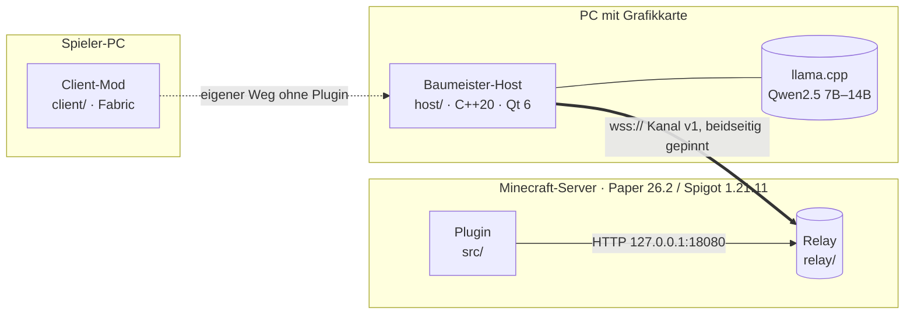
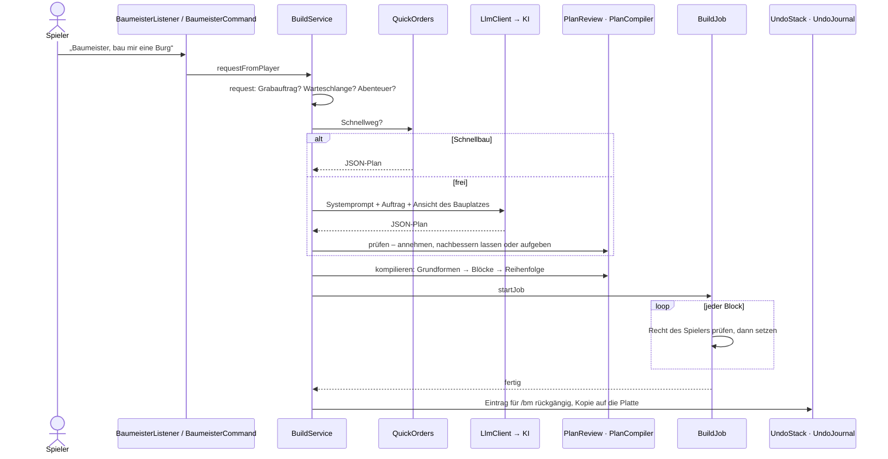

<div align="center">

# Entwicklung

**Wie der Baumeister aufgebaut ist, wo man anfängt zu lesen und wie geprüft wird.**

[Überblick](#überblick) · [Ein Auftrag durch den Code](#ein-auftrag-durch-den-code) · [Pakete](#pakete) ·
[Grundregeln](#grundregeln-im-code) · [Bauen](#bauen) · [Testen](#testen) · [Wo anfangen](#wo-anfangen) ·
[Doku und Bilder](#doku-und-bilder)

</div>

Für Spieler gibt es die Seite [Spielen](spielen.md), für Betreiber die [Installation](installation.md) und das
[Handbuch](handbuch.md). Wie ein Beitrag abläuft (Issue, Branch, Pull Request, Commit-Stil):
[CONTRIBUTING.md](../CONTRIBUTING.md).

## Überblick



| Teil | Sprache | Aufgabe | Mehr |
|---|---|---|---|
| Plugin | Java 21, Maven | Aufträge verstehen, Pläne prüfen und kompilieren, NPC baut, Vera, Weltbau | dieses Dokument |
| Relay | Java 21, nur JDK | hält `127.0.0.1:18080` für das Plugin, nimmt die App per TLS mit gepinntem Zertifikat an | [Kanal v1](kanal-v1.md), [Fernverbindung](fernverbindung.md), [Einrichtung](../relay/deploy/README.md) |
| Baumeister-Host | C++20, Qt 6, llama.cpp | Modell auf der Grafikkarte, Grammatik erzwingt das Planschema, Live-Konsole | [host/README.md](../host/README.md) |
| Client-Mod | Java, Fabric | baut mit der eigenen Spielfigur, auch ohne Plugin | [client/README.md](../client/README.md) |

Ohne KI läuft vieles weiter: Schnellbau, Tunnel, Schematics, Maschinen, Städte und der größte Teil von Vera brauchen
kein Modell. Die KI liefert nur einen Bauplan in einem festen JSON-Schema
([`plan-schema.json`](../src/main/resources/plan-schema.json)); was gebaut wird, entscheidet immer das Plugin.

## Ein Auftrag durch den Code



Grabaufträge (Tunnel, Treppe, Brücke) zweigen früh ab: `BuildService.request` reicht sie an `TunnelService`, der
`TunnelOrder` (Satz verstehen), `TunnelScan` (Vorhandenes erkennen) und `TunnelShape` (Abschnitt für Abschnitt
planen) aus dem Paket `plan` benutzt – nie das LLM.

## Pakete

Alles unter [`src/main/java/com/blackn0va/baumeister/`](../src/main/java/com/blackn0va/baumeister):

| Paket | Wofür | Einstieg |
|---|---|---|
| *(Wurzel)* | Bukkit-Seite: Start, Befehle, Chat, Bauaufträge, NPC, Rückgängig, Stadt- und Weltbau, Vera-Dienst | `BaumeisterPlugin`, `BaumeisterCommand`, `BuildService`, `BuildJob`, `TunnelService`, `CompanionService` |
| `plan` | **ohne Bukkit**: Planschema, Compiler, Prüfer, Schnellbau, Maschinen, Tunnel, Blockstufen | `PlanCompiler`, `PlanReview`, `QuickOrders`, `Machines`, `TunnelShape`, `BlockTiers` |
| `companion` | Vera: Absichten, Wege, Charakter, Abenteuer, Sprache | `CompanionIntent`, `CompanionRules`, `CompanionPath`, `Adventure` |
| `osm` | Städte aus OpenStreetMap | `OsmImport`, `CityPlanner` |
| `earth`, `terrain` | Erdwelt und Gelände 1:1 aus Höhendaten | `EarthService`, `EarthTerrain`, `TerrainPopulator` |
| `logic` | Schaltungen aus Formeln, 7-Segment-Anzeige | `LogicCircuit`, `LogicMinimizer` |
| `redstone` | Schaltungen lesen, prüfen, ausprobieren, reparieren | `RedstoneReader`, `RedstoneRepair` |
| `structure` | Schematic-Dateien lesen und schreiben (`.schem`, `.litematic`, `.nbt`) | `StructureFile`, `PlanDecompiler` |
| `help`, `quest`, `warp`, `rucksack`, `portal`, `minimap`, `screen` | Hilfebuch, Tagesaufgaben, Warps, Rucksack, Portale, Minikarte, Bildschirm aus Karten | `HelpBook`, `DailyQuests`, `RucksackLogic`, `MinimapImage` |

Ressourcen in [`src/main/resources/`](../src/main/resources): `config.yml` (Vorlage, jede Einstellung mit Kommentar),
`system-prompt.txt` und `plan-schema.json` für die KI, `begleiter-prompt.txt` für Vera, `plugin.yml`.

## Grundregeln im Code

- **`plan` bleibt ohne Bukkit.** Alles, was sich rechnen lässt – Pläne, Formen, Drehungen, Tunnelabschnitte –, liegt
  dort und ist ohne Server testbar. Die Wurzel übersetzt nur zwischen Welt und Plan (`TunnelSite`, `BuildJob`).
- **Fail-closed bei Rechten.** Jeder Block wird im Namen des Spielers geprüft, bevor der erste gesetzt wird
  (`RegionCheck`, `BuildRights`; ausgelöste BlockPlace-/BlockBreak-Ereignisse, damit WorldGuard und PlotSquared
  greifen). Gefährliches und Befehlsblöcke brauchen eigene Stufen (`BlockTiers`). Was ein Spieler nicht selbst setzen
  dürfte, setzt auch der Baumeister nicht.
- **Hauptthread schonen.** Die KI fragt asynchron, die Welt ändert sich nur im Hauptthread – in Zeitscheiben
  (`TimeSlice`, `LoadControl`, `ChunkPrefetch`). `TickMonitor` misst, `LagWatch` baut Dauerläufer wieder ab. Der
  Testserver dev01 ist ein Celeron ohne AVX: Was dort flüssig läuft, läuft überall.
- **Nichts geht verloren.** `UndoStack` hält 50 Einträge, die neuesten 5 im Speicher, ältere auf der Platte
  (`UndoJournal`, beim Start fail-closed geprüft). `UndoCheck` setzt je Zelle nur zurück, wo noch steht, was der Bau
  gesetzt hat. `RestoreJob` setzt gedrosselt zurück; der Ordner `wiederherstellen/` holt Schäden ohne Konsole zurück.
- **Einstellungen ändern nie still.** `ConfigMigration` ergänzt fehlende Schlüssel, ändert keinen Wert; `ConfigCheck`
  kennt die Grenzen; `/bm neuladen` sagt, was sofort gilt (`ReloadPlan`).
- **Kommentare sagen warum.** Deutsch, mit dem, was vorher war, dem Messwert oder dem Vorfall und was passiert, wenn
  man es zurückdreht. Namen von Klassen und Methoden auf Englisch. Mehr in [CONTRIBUTING.md](../CONTRIBUTING.md).

## Bauen

| Teil | Voraussetzung | Befehl |
|---|---|---|
| Plugin | Java 21, Maven, die Server-APIs in `lib/` ([woher](../lib/README.md)) | `mvn package` → `target/Baumeister-<fassung>.jar` |
| Relay | Java 21, Maven | `mvn -f relay/pom.xml package` |
| Host | Windows, Build Tools 2022, Qt 6 – `host/einrichten.ps1` richtet alles ein | `pwsh -File host/build.ps1` |
| Client-Mod | Java 25 | `./gradlew build` in `client/` |
| Alles als Paket | PowerShell 7 | `pwsh -File tools\paket\Paket-Erstellen.ps1` |

## Testen

Vier Ebenen, von schnell nach echt:

| Ebene | Was | Wie |
|---|---|---|
| **Unit-Tests** | 249 Testklassen, 1 674 Tests (2026-11-17), JUnit 5, im selben Paket wie der Code, Fakes statt Mocks | `mvn test` |
| **Gegenprobe** | Jeder Fix gilt erst, wenn der Test ohne ihn rot ist: Regel ausbauen → rot, zurück → grün. Beide Läufe gehören in den Commit. | Mutation von Hand oder per Skript |
| **Messproben** | kleine Programme, die eine Frage am echten Verhalten klären – Blockzustände, Licht, Physik des NPC, Vera ohne Modell | [`probes/`](../probes) und `*Probe.java` im Testcode |
| **Live auf Testservern** | dasselbe Jar auf einem lokalen Paper 26.2 und Spigot 1.21.11, gesteuert über RCON (`/bm bauenbei`, `/bm maschine`, `execute if block`) – Maschinen in allen vier Richtungen | z. B. `MachineProbe`, `LogicProbe` im Testcode |

Ein Beispiel für eine Messprobe mit Gegenprobe:
[`MachineProbe`](../src/test/java/com/blackn0va/baumeister/MachineProbe.java) baut jede Maschine über `/bm maschine`,
legt jede Eingangsbelegung an und fragt die Ausgänge ab; mit `ohne=x,y,z` entfernt sie ein tragendes Teil – meldet die
Maschine dann trotzdem „bestanden“, prüft der Ablauf das Teil nicht.

## Wo anfangen

| Du willst … | Lies zuerst | Test daneben |
|---|---|---|
| einen Schnellbau hinzufügen | `plan/QuickOrders`, `plan/QuickForms` | `QuickOrdersTest` |
| eine Maschine hinzufügen | `plan/Machines` | `MachinesTest`, live `MachineProbe` |
| am Tunnel arbeiten | `plan/TunnelOrder`, `plan/TunnelShape`, `plan/TunnelScan`, `TunnelService` | `TunnelShapeTest`, `TunnelScanTest` |
| Vera einen neuen Satz beibringen | `companion/CompanionIntent`, `companion/CompanionRules` | `CompanionIntentTest`, `CompanionRulesTest` |
| einen Befehl hinzufügen | `BaumeisterCommand`, `help/HelpBook` | `BaumeisterCommandTest` |
| verstehen, was die KI bekommt | `src/main/resources/system-prompt.txt`, `plan/PlanPrompt`, `plan/PlanReview` | `PlanReviewTest` |
| Rechte und Stufen | `RegionCheck`, `BuildRights`, `plan/BlockTiers` | `BlockTiersTest` |

## Doku und Bilder

- **README kurz mit Bildern**, der Volltext steht im [Handbuch](handbuch.md); Spieler lesen [Spielen](spielen.md).
- **Stand ehrlich:** die Tabelle im README („Was geht, was noch nicht“) und das ausführliche Prüfprotokoll im
  [Handbuch](handbuch.md#stand) – was nur per Test oder ohne Spieler geprüft ist, steht dort so.
- **Bilder aus dem echten Code** statt Bildschirmfotos (keine Spiel-Texturen):
  [`ReadmeBilder`](../src/test/java/com/blackn0va/baumeister/bilder/ReadmeBilder.java) zeichnet Schnellbau, Tunnel,
  Maschinen, Stadt, Hilfebuch und Katalog aus denselben Plänen, die der Baumeister baut. Nach `mvn test-compile`:

  ```bash
  java -cp "target/classes;target/test-classes;lib/*" com.blackn0va.baumeister.bilder.ReadmeBilder docs/bilder
  java -cp "target/classes;target/test-classes;lib/*" com.blackn0va.baumeister.bilder.ReadmeBilder docs/bilder tunnel
  ```

  (Unter Linux und macOS `:` statt `;` im Klassenpfad.)
- **CHANGELOG** nach [Keep a Changelog](https://keepachangelog.com/de/1.1.0/), auf Deutsch: was sich für Spieler und
  Betreiber ändert, mit Grund.
