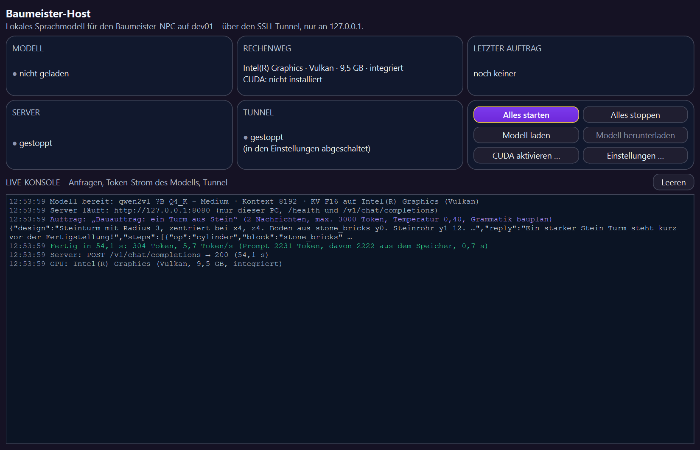
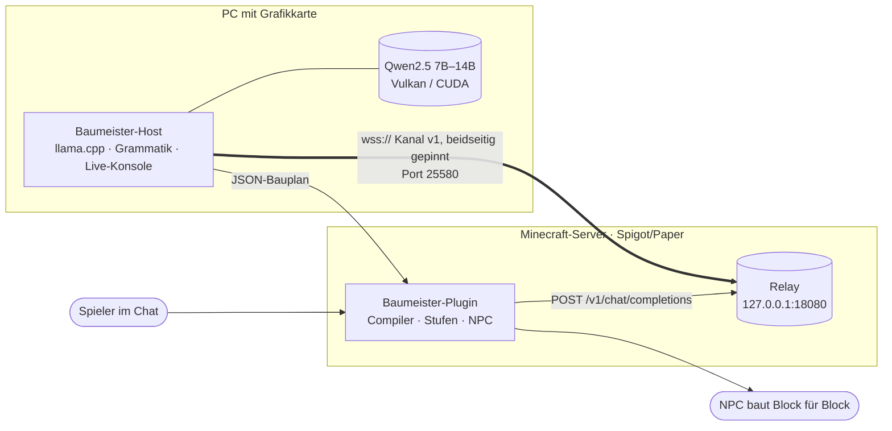

<div align="center">

# Baumeister – Handbuch

**Alles im Detail. Der Überblick steht in der [README](../README.md).**

    

[Installation](installation.md) · [Schematics](schematics.md) · [Aufbau](#aufbau) · [Ablauf](#ablauf) · [Starten](#starten) · [Befehle](#befehle) · [Bauplan](#bauplan) · [Logik](#logik-schaltungen-aus-formeln) · [Komfort](#komfort) · [Gelände](#gelände-11) · [Erde](#die-ganze-erde-11) · [Städte](#städte-und-dörfer-11) · [Betrieb](#betrieb) · [Sicherheit](#sicherheit) · [Eigenes Modell](#eigenes-modell) · [Bauen](#bauen-und-testen) · [Stand](#stand)

</div>



## Aufbau



Läuft die KI auf demselben Rechner wie der Server, entfällt das Relay: Das Plugin fragt dann direkt
`127.0.0.1:8080` (Baumeister-Host) oder `127.0.0.1:11434` (Ollama).

| Ordner | Inhalt |
|---|---|
| [`src/`](../src) | Plugin für Spigot/Paper (Java 21, Maven): Chat-Auftrag, Bauplan-Compiler, Rechteprüfung, Mannequin-NPC |
| [`host/`](../host) | **Baumeister-Host** – Windows-App (C++20, Qt 6, llama.cpp) für einen PC mit Grafikkarte: Modell, Server, Fernverbindung (Relay oder SSH-Tunnel), Live-Konsole ([README](../host/README.md)) |
| [`relay/`](../relay) | **Relay** auf dem Minecraft-Server (Java 21, nur JDK): hält 127.0.0.1:18080 für das Plugin und nimmt die App per TLS mit gepinntem Zertifikat an ([Einrichtung](../relay/deploy/README.md), [Kanal v1](kanal-v1.md), [Fernverbindung](fernverbindung.md)) |
| [`client/`](../client) | Fabric-Mod: der Baumeister baut mit deiner eigenen Spielfigur, auch ohne Server-Plugin |
| [`llm-host/`](../llm-host) | Notweg: `start-llm.ps1` (llama-server + SSH-Tunnel in PowerShell), vom Host abgelöst |
| [`lib/`](../lib) | Server-APIs zum Kompilieren, nicht im Repo (Herkunft und Hashes: [`lib/README.md`](../lib/README.md)) |

Gemessen und gebaut wird auf einem kleinen Testserver des Projekts („dev01“: Celeron J4125, 4 Kerne, 8 GB, kein
AVX, Paper 26.2 auf Java 25). Wo Kommentare oder dieses Handbuch „dev01“ nennen, ist dieser Rechner gemeint – er
zeigt, wie sich das Plugin auf schwacher Hardware verhält.

## Ablauf

```
Chat: "Baumeister, bau mir ein kleines Haus aus Fichtenholz"
  → Plugin  ──HTTP──▶  127.0.0.1:18080 (Relay) bzw. direkt die KI auf demselben Rechner
                                   │  TLS-Kanal zur Baumeister-App
                                   ▼
                              llama.cpp in der App (Qwen2.5 7B–14B, Grammatik erzwingt das Schema)
  ◀── JSON-Bauplan
  → Compiler: Grundformen → Blöcke → Reihenfolge (Schritt, Schicht von unten, nächster Nachbar)
  → Rechteprüfung jedes Blocks im Namen des Spielers (WorldGuard/PlotSquared)
  → NPC (Mannequin) fliegt hin, schaut, schwingt den Arm, setzt den Block mit Geräusch
```

Ein Server ohne AVX (wie dev01) rechnet ein LLM unbrauchbar langsam – deshalb kann die KI auf einem anderen PC laufen.

## Starten

**Installieren:** [`docs/installation.md`](installation.md) – drei Stufen (nur Plugin · KI auf demselben PC · KI
auf einem anderen PC über das Relay), Rechte, Mods für Spieler. Alles in einem Paket:
`pwsh -File tools\paket\Paket-Erstellen.ps1` → `out\paket\Baumeister-<fassung>.zip` (veröffentlicht nichts).

**Modpaket für Spieler:** `pwsh -File tools\modpaket\Modpaket-Erstellen.ps1 -ModsOrdner <ordner>` baut `.mrpack`
und ZIP; mit `-Hochladen -Server root@<server>` legt es beides auf dem Server ab. Mit `mods.download.an: true` gibt
`/mods` jedem Spieler einen eigenen Link (24 h) auf Port 25581 – ohne Link kommt niemand an die Dateien.

1. Auf dem PC mit der KI: **BaumeisterHost** starten – lädt Modell, Server und Verbindung von selbst (Einrichtung und
   Bau mit einem Doppelklick: [`host\einrichten.cmd`](../host/README.md#schnellstart)).
2. Im Spiel als OP: `/bm spawn` – oder einfach loslegen, der NPC erscheint beim ersten Auftrag.
3. Im Chat: `Baumeister, bau mir einen runden Turm aus Steinziegeln`

Ein Plan braucht 1–3 Minuten (gemessen: 42–102 s), das Bauen danach ~7 Blöcke/s.

## Befehle

| Befehl | Wer | Wirkung |
|---|---|---|
| `Baumeister, …` / `@Baumeister …` im Chat | `baumeister.bauen` | Bauauftrag vor dir, in Blickrichtung |
| `/bm bau <auftrag>` | `baumeister.bauen` | dasselbe als Befehl |
| `/bm stop` | Auftraggeber, Admin | Bau anhalten |
| `/bm rückgängig` | Auftraggeber, Admin | letzten Bau exakt zurücksetzen (5 Bauten, auch nach einem Neustart, siehe [Komfort](#komfort)) |
| `/bm vorschau <auftrag>` · `vorschau ja\|nein` · „Baumeister, zeig mir …“ im Chat | `baumeister.bauen` | planen und den Umriss als Partikel zeigen; „ja“ baut, „nein“ verwirft |
| `/bm warteschlange` · `warteschlange abbrechen [platz\|alle]` | `baumeister.bauen` | wartende Aufträge zeigen · eigene herausnehmen (`alle` und fremde nur Admins) |
| `/bm status` | alle mit `baumeister.bauen` | Zustand, NPC, LLM erreichbar? |
| `/bm spawn [spieler]` | `baumeister.admin` | NPC hierher, optional mit Skin eines Online-Spielers |
| `/bm entfernen` · `/bm neuladen [erzwingen]` | `baumeister.admin` | NPC weg · config.yml neu lesen, ohne laufende Bauten anzufassen – sagt, was sofort, nach dem laufenden Auftrag oder erst nach einem Neustart gilt; Bau-Einstellungen bei vollem Rückgängig-Stapel nur mit `erzwingen` |
| `/bm leistung` | `baumeister.admin` | letzte Minute: TPS, Tick-Abstand, Rechenzeit des Hauptthreads, Heap und GC-Pausen, geladene hohe Chunks gegen das HeapGuard-Budget, laufende Aufträge und Warteschlangen |
| `/bm lagprobe <welt> <x1> <y1> <z1> <x2> <y2> <z2> [s]` | `baumeister.admin` | zählt, was im Bereich ohne Eingabe von selbst schaltet (Redstone, Kolben, Werfer, Trichter, neue Objekte), je Sekunde – dieselbe Messung, mit der der Lag-Wächter nach jedem Bau Dauerläufer über `bau.lag-grenze-je-sekunde` (50) wieder abbaut |
| `/bm spielbauwerk <art> [1-5]` · `/bm spielbauwerk liste` | `baumeister.admin` | lässt das Spiel Bauwerke (Wüstentempel, Dörfer, Bastion, Prüfungskammern, antike Stadt …) in der Flachwelt `baumeister_vorlagen` erzeugen und speichert sie als Vorlagen unter `schematics/spiel/` – danach baut der Baumeister sie wie jede Schematic, nach spätestens 30 s im Katalog |
| `/bm bauenbei <welt> <x> <y> <z> <n\|o\|s\|w> <auftrag>` | `baumeister.admin` | Konsole/RCON, ohne Spieler-Rechteprüfung |
| `/bm maschine <name> [<welt> <x> <y> <z> <n\|o\|s\|w>]` | `baumeister.admin` | eingebaute Maschine direkt bauen, ohne LLM (ohne Koordinaten: 2 Blöcke vor dir) |
| `/bm befehlsblock [befehl]` | `baumeister.admin.befehlsblock` | Befehlsblock, auf den du schaust: zeigen (Befehl zum Anklicken) bzw. setzen – in jedem Spielmodus, mit Baurecht an der Stelle |
| `/bm befehle ja\|ohne\|nein <code>` · Knöpfe unter der Liste | Auftraggeber | Befehle aus einem Bauplan bestätigen, ohne sie bauen oder verwerfen (10 Minuten gültig) |
| `/bm selbsttest blöcke\|daten\|stabil [liste] [<welt> <x> <y> <z>]` | `baumeister.admin` | jeden Blockzustand über den Weg eines Baus setzen und zurücklesen (Liste im Plugin-Ordner, z. B. aus `src/test/resources/blockstates/`), Datenbeispiele, Angleichung durch Minecraft – nur auf Testservern |
| `/bm stadt <Ort\|PLZ\|lat,lon> [radius]` | `baumeister.admin` | echten Ort aus OpenStreetMap laden und planen, auch per Postleitzahl (`71735`, `8001 ch`), siehe [Städte](#städte-und-dörfer-11) |
| `/bm stadt los [echt \| <welt> <x> <y> <z>]` · `stadt abbrechen` | `baumeister.admin` | geplanten Ort bauen (Mitte unter dir; `echt` = an seiner echten Stelle in der Stadtwelt) · verwerfen |
| `/bm pause` · `weiter` · `tempo <n>` | `baumeister.admin` | laufenden Stadtbau steuern |
| `/bm helfer <0–16\|auto>` | `baumeister.bauen` (Stadtbau: `baumeister.admin`) | Helfer für den eigenen Bau – sofort und für die nächsten; auch „… mit 4 Helfern“ im Auftrag, „mehr helfer“ im Chat |
| `/bm fortschritt` · `/bm komm` | `baumeister.bauen` | Stand mit Restzeit · Baumeister zu dir holen |
| `/bm stadtwelt` | `baumeister.admin` | flache Welt für Stadtbauten anlegen bzw. hinreisen |
| `/bm logik <Formel>` · `Baumeister, logik: <Formel>` im Chat | `baumeister.admin` | Redstone-Schaltung aus einer Formel, mehrere Ausgänge mit `;` getrennt, 2 Blöcke vor dir, siehe [Logik](#logik-schaltungen-aus-formeln) |
| `/bm logikbei <welt> <x> <y> <z> <n\|o\|s\|w> <Formel>` | `baumeister.admin` | dasselbe für Konsole/RCON |
| `/bm gelaende <Ort\|lat,lon> [radius]` | `baumeister.admin` | echtes Gelände 1:1 aus Höhendaten, siehe [Gelände](#gelände-11) |
| `/bm gelaende einrichten` | `baumeister.admin` | Datapack für die 4 064 Blöcke hohe Geländewelt (wirkt nach Neustart) |
| `/bm erde` | `baumeister.admin` | in die Erdwelt (ganze Erde 1:1), an deine letzte Stelle, sonst nach Hepberg, siehe [Erde](#die-ganze-erde-11) |
| `/bm reise <Ort\|lat,lon>` | `baumeister.admin` | an jeden Ort der Erde in der Erdwelt; das Ziel wird ein Reisepunkt |
| `/bm wo [x z]` | `baumeister.admin` | lat/lon, echte Meereshöhe, Bezug, Maßstab und wohin Norden zeigt |
| `/bm weltbau <Ort\|lat,lon> [radius]` · `weltbau auto an\|aus` · `status` · `stop` · `rückgängig [tx tz]` | `baumeister.admin` | Häuser, Straßen, Wasser, Bäume aus OpenStreetMap in der Erdwelt nachbauen, automatisch rund um die Spieler |
| `/bm orte [seite\|suchwort]` · `/bm ort <Name>` | `baumeister.reisen` | Reisepunkte anklickbar listen · hinreisen (jede gebaute Stadt, jedes Gelände, jedes Reiseziel) |
| `/bm ort merken <Name>` · `/bm ort löschen <Name>` | `baumeister.admin` | eigenen Reisepunkt hier anlegen · löschen |
| `/bm karte` · mit der Karte: Linksklick/Rechtsklick (Schleichen: schneller) · `karte zoom <1/16–64>` · `karte drehen an\|aus` · `karte status` | `baumeister.bauen` oder `baumeister.reisen` | Minikarte in die Hand: mitwandernd und mitdrehend, Plotgrenze, weiße Straßen, Baustelle, Baumeister und Helfer, Reisepunkte; weit draußen aus der Übersicht |
| `/bm karte punkt <Name> [x z]` · `punkte` · `weg <Name>` · `ziel <Name\|aus>` | `baumeister.bauen` oder `baumeister.reisen` | eigene Wegpunkte; das Ziel steht mit Entfernung auf der Karte, am Rand in seiner Richtung |
| `/bm kartenbild <welt> <x> <z> [zoom] [blick]` | `baumeister.admin` | Kartenbild als PNG nach `plugins/Baumeister/minikarte/` (Prüfung ohne Spieler) |
| `Baumeister, vergiss das` im Chat | `baumeister.bauen` | Gedächtnis an den letzten Bau löschen – der nächste Auftrag ist ein Neubau |

Beide Rechte sind standardmäßig nur für OPs. Dazu die Stufen-Rechte (alle Vorgabe op, Kinder von `baumeister.admin`):
`baumeister.bauen.inhalte` (Behälter mit Inhalt auch ohne Kreativmodus), `baumeister.admin.gefaehrlich` (Lava, TNT, <!-- umlaut-ok: Rechtename -->
Feuer, Spawner, Grundgestein abtragen …) und `baumeister.admin.befehlsblock` (Befehls-, Konstruktions- und Testblöcke
samt Daten). Wer in LuckPerms `*` oder `baumeister.admin` hat, darf alles wie ein OP.

## Bauplan

Das LLM liefert Grundformen statt Einzelblöcken: `fill`, `walls`, `hollow`, `line`, `set`, `cylinder`,
`sphere`, `roof` (gable/hip/flat mit Treppen, Überstand, Giebel), `door`, `skyscraper`, `house`, `castle`, `wall`,
`bridge`, `garden`, `tree`, `module` und `logic`. Koordinaten sind lokal
(x rechts, z vom Spieler weg, y=0 Boden); das Plugin dreht sie in deine Blickrichtung. Schema:
`src/main/resources/plan-schema.json`, Anweisung: `src/main/resources/system-prompt.txt`.

**Recherche:** Steht ein echtes Bauwerk im Auftrag („bau den Kölner Dom“, „den Eiffelturm“), schlägt der Baumeister
es vorher bei Wikipedia/Wikidata nach (Maße, Art, Baustil, Material, kurze Beschreibung) und gibt das dem LLM mit –
maßstabsgetreu oder auf `bau.max-ausdehnung` verkleinert; die Höhe prüft der Plan-Prüfer nach. Ein Wikipedia-Treffer
zählt nur, wenn sein Titel im Auftrag steht, und nur mit Maßen in Wikidata. Ohne Netz plant das LLM wie bisher.

**Hochhäuser** (`skyscraper`): Das LLM nennt nur Grundriss, Geschosszahl und Material; das Plugin rechnet Geschosse
von 4 Blöcken, Decken, Fensterbänder mit Pfeilern, Licht, einen Leiterschacht bis aufs Dach, den Eingang und ein
Flachdach mit Brüstung. Vorher entwarf das Modell Hochhäuser selbst – Llama 3.1 8B baute „40 Stockwerke“ als
40 Blöcke hohen Vollzylinder und stapelte beim nächsten Versuch Logikgatter in die Fassade. Bauteile (`module`)
setzt es jetzt nur noch, wenn ausdrücklich eine Maschine verlangt ist. Große Pläne (mehr als 120 s Block für Block)
baut der Baumeister im Schnellgang: 30 Stockwerke, 31 111 Aktionen in 45 s auf dem Testserver.

**Wohnhäuser** (`house`): Grundriss, Geschosse (1–4) und Holz/Stein – das Plugin baut Boden, Decken, Eckstämme, Tür,
Fensterreihen, Leiter, Satteldach und richtet nach Größe ein (Werkbank, Truhe, Ofen, hängende Laterne, Tisch mit
Stühlen, Bücherregal, Teppich). Auf dem Testserver: zweistöckiges Fichtenhaus 9 × 11, 1 081 Aktionen in 24 s, alles
nachgemessen (Leiter durchgehend, Tür ganz, je Geschoss Einrichtung).

**Bauformen** (`castle`, `wall`, `bridge`, `garden`, `tree`): Wie beim Hochhaus nennt das LLM nur Ort, Maße und
Material (Felder `width` und `style`), die Geometrie rechnet das Plugin (`plan/Structures.java`).
- Burg: Mauerring mit Zinnen und Wehrgang, vier Ecktürme (rund oder eckig) mit Turmstube und Leiter, Torhaus mit
  3 Blöcke breiter Durchfahrt. Hof, Torstube, Wehrgang und Türme sind zu Fuß erreichbar.
- Mauer: Mauerzug zwischen zwei Bodenpunkten mit gleichem y (auch schräg), Zinnen außen, Wehrgang und Leiter innen.
  Verschiedene y lehnt der Parser ab – das ist fast immer der Tippfehler `wall` statt `walls`.
- Brücke: Steinbogen oder Holzbalken auf Pfeilern, Geländer, Laternen alle 6 Blöcke.
- Garten: Rasen, Wege, Blumenbeete, Zaun mit Tor und Laternen, ab 11 × 11 zwei Bäume.
- Baum: Laubbaum (`round`) oder Nadelbaum (`cone`), 4–32 Blöcke, ab 14 mit 2 × 2-Stamm.

Höhe, Dicke und Turmradius außerhalb der Grenzen einer Form (aber im Schema) kappt der Compiler mit Warnung, ohne
Reparaturrunde. Alles bleibt im angegebenen Rechteck, nichts schwebt (Unit-Tests in allen vier Richtungen).

**Plot-Modus (PlotSquared):** „bau das World Trade Center auf meinem Plot“ – der ganze Plot, auf dem du stehst, wird
bebaut: Hauptbau mittig (LLM, Recherche oder Schnellauftrag), drumherum Rasen, Hecke, Weg mit Laternen, Blumen. Was
nicht passt, geht zur Nachbesserung oder wird mit Maßen abgesagt; fremde Plots und vorhandene Bauten bleiben geschützt.

**Schnellaufträge ohne LLM:** „Hochhaus mit 20 Stockwerken“, ein Maschinenname, „bau mir eine fette Maschine“,
„bau mir hier Fort Knox“ (Golddepot 32 × 37 m mit Tresor über zwei Ebenen unter der Erde), „bau einen (großen) Bunker“
(1–3 Ebenen unter einem getarnten Eingang), „bau einen (kleinen/großen) Pool“ (Becken 5×7 bis 11×17, Wasser auf
Bodenhöhe, Terrasse, Leiter, Licht im Boden), „bau einen Taschenrechner“ (2-Bit-Addierer)
(Maschinenhalle mit bis zu 6 Anlagen, Testserver: 1 726 Blöcke in 91 s), „bau mir einen Prozessor aus Redstone“
(Prozessor-Werkstatt: Takt, Zähler, 4-Bit-Register, D-Speicher, ALU-Scheibe, Addierer, Vergleicher – jeder Baustein
im Spiel geprüft) oder eine Bauform baut sofort, auch wenn das
LLM nicht erreichbar ist (Testserver: 20 Stockwerke in 52 s, LLM aus). Steht an der Stelle schon ein Bauwerk, rückt
der Schnellauftrag zur nächsten freien Stelle daneben, statt verworfen zu werden. Bauformen verstehen Größe und
Material: „bau eine Burg“, „eine große Burg aus Sandstein“, „eine Burg 40 Blöcke breit“, „eine Brücke über 20 Blöcke“
(Spannweite) bzw. „12 Blöcke lang“ (ganze Brücke), „eine Stadtmauer 30 Blöcke lang“, „ein Garten“, „eine kleine
Tanne“. Ein Bauteil der Bibliothek mit gleichem Namen hat Vorrang. Bei allen anderen Aufträgen bekommt das LLM die
erkannten Fakten (Stockwerke, Material, Maschine ja/nein, Bauform) mit, und ein Plan, der ihnen widerspricht, geht zur
Nachbesserung zurück.

**Plan-Prüfer:** Nach dem Übersetzen prüft `PlanLinter` den Plan mit Blick auf den fertigen Bau: Tür oder Fenster nicht
in der Wand, Laterne/Fackel ohne Halt, eingemauertes Wasser, Vollklotz statt Hohlraum, schwebende Teile, zwei Bauteile
im selben Raum. Gelände und Bestand am Bauplatz zählen als Halt – eine Plattform auf einem Hügel schwebt nicht. Schwere
Befunde gehen als kurze Rückmeldung (höchstens drei Punkte) in die vorhandene Reparaturrunde; ein sauberer Plan kostet
keinen weiteren LLM-Aufruf. Bleibt der Fehler, sagt der Baumeister ab (Hochhaus: bewährter Ersatzbau). Mit
`llm.plan-prüfer: reparieren` baut er trotzdem, mit `aus` prüft er nicht.

**Anbauen:** Bei „bau rechts eine Werkstatt an“, „…daneben“ oder „anbauen“ legt das Plugin die Anschlusswand selbst
fest: am größten Bauwerk, auf der genannten Seite (rechts/links/hinten/vorne), sonst auf der mit dem meisten Platz. Das
LLM bekommt Wandebene, Bodenhöhe und freie Tiefe als feste Vorgabe. Landet sein Plan trotzdem auf dem Dach, im Haus
oder mit Lücke daneben, rückt das Plugin ihn an die Wand; die bestehende Wand bleibt und wird geteilt. Der
Überbau-Schutz prüft das Ergebnis unverändert. Nicht ausgerichtet wird bei „erweitern“, „verbinden“, „dran“, bei
Stockwerk/Etage/aufstocken/Dach, bei Plänen, die zwei Bauwerke verbinden, und bei Folgeaufträgen mit Gedächtnis.

**Kisten sind tabu:** Steht im Bauplatz eine Truhe, ein Fass, Ofen, Trichter … mit Inhalt, bricht ein Bau vor dem
ersten Block mit genauer Stelle ab (Rückgängig kann Inhalte nicht zurückholen); der Stadtbau baut um sie herum.

Jede Rohantwort liegt unter `plugins/Baumeister/pläne/` (die letzten 50) – zum Nachsehen, was das
Modell wirklich geschrieben hat.

## Maschinen

Ein LLM entwirft Redstone aus dem Kopf praktisch nie funktionsfähig. Deshalb gibt es **geprüfte Maschinen im Code**
(`plan/Machines.java`), die das LLM nur platziert (`op: module`) – oder ein Admin direkt mit `/bm maschine`:

| Name | Funktion | Ein-/Ausgang |
|---|---|---|
| `nicht_gatter` | NICHT | Hebel vorne, Lampe hinten |
| `oder_gatter` | ODER | Hebel A/B vorne, Lampe hinten |
| `und_gatter` | UND | Hebel A/B vorne, Lampe hinten |
| `xor_gatter` | Exklusiv-ODER (Komparatoren) | Hebel A links, B rechts, Lampe Mitte |
| `takt` | Taktgeber, ~1 Hz | Lampe oben blinkt |
| `kolbentuer` | Kolbentür 1×2 | Hebel vorne links: an = zu |
| `halbaddierer` | Halbaddierer, erste Stufe eines Rechenwerks | Hebel A links, B rechts; Lampe S (Summe) Mitte, C (Übertrag) hinten |
| `rs_speicher` | 1-Bit-Speicher (RS-Latch) | Hebel S setzt, R löscht; Lampe Q hält den Zustand |
| `automatiktuer` | Eisentür mit Druckplatten | Platte vorn oder hinten öffnet |
| `wasserfahrstuhl` | Blasensäule über Seelensand | Tür unten, oben aussteigen (5 Blöcke) |
| `abwaerts_fahrstuhl` | Blasensäule über Magma | oben einsteigen, unten Tür |
| `nand_gatter` · `nor_gatter` · `xnor_gatter` | NAND, NOR, XNOR (Gleichheit) | Hebel A/B, Lampe |
| `t_flipflop` | Umschalter mit Kupferbirne | jeder Impuls schaltet die Lampe um |
| `lampenreihe` | Lichtschalter für 5 Lampen | Hebel vorne links |
| `nachtlicht` | umgekehrter Tageslichtsensor | Lampe nachts an |
| `klingel` · `glocke` | Notenblock mit Knopf · Dorfglocke mit Hebel | Knopf bzw. Hebel |
| `sammelstelle` | zwei Trichter in eine Truhe | Grundbaustein für Farmen |
| `kombischloss` | Zahlenschloss aus drei Hebeln | nur A an, B aus, C an öffnet die Eisentür |
| `pfeilfalle` | Werfer mit Druckplatte | wer drauftritt, löst einen Pfeil aus |
| `zaehler` | 2-Bit-Zähler aus Kupferbirnen | zählt Impulse 0–3, Lampen Q0/Q1 |
| `zuckerrohrfarm` | Beobachter + Kolben | erntet Zuckerrohr selbsttätig |
| `xp_farm` | Mobfarm ohne Spawner, Plattform 22 Blöcke hoch | Mobs kommen mit 1–2 Leben in der Schlagkammer vorn an, Beute in den zwei Truhen im Boden vor der Scheibe |
| `weizenfarm` | Weizenfeld 9 × 7 zum Spülen, braucht freien Himmel | Wassereimer in die neun Spender hinten; Hebel hinten rechts an: Ernte in Trichter und Truhe vorn rechts, aus und wieder an: Wasser zurück |
| `eisenfarm` | Eisenfarm ohne Lava: ein Teich trägt die Golems in eine Grube mit Seelenlagerfeuern; Golems kommen tagsüber (nachts schlafen die Bewohner) | 3 Betten oben hinten durch den Spalt unter dem Glasdach, je ein Dorfbewohner darauf, Zombie mit Namensschild in den Käfig dahinter (getöntes Glas kurz abbauen); Golems nach der ersten Nacht, Eisen in der Truhe unten rechts |
| `huehnerfarm` | drei Glaskammern über Trichtern | je ein Huhn hinein (oder Eier werfen), Eier in der Truhe rechts |
| `kuerbisfarm` · `melonenfarm` | vier Stängel, Beobachter am Stängel + Kolben | Früchte zerbrechen von selbst, aufsammeln |
| `bambusfarm` · `kaktusfarm` | Beobachter + Kolben · Zaunpfosten am dritten Stück | Ernte aufsammeln (Kaktus: ein Teil verbrennt am Kaktus) |
| `bruchsteingenerator` | Lava neben Wasser | Lava ins linke Fach gießen, Bruchstein vorn abbauen, er kommt nach |
| `volladdierer` | Volladdierer aus dem Logik-Compiler (A + B + Übertrag) | Hebel A, B, CI links von vorn nach hinten; Lampe S hinten links, CO (Übertrag) hinten rechts |
| `impulsverlaengerer` | hält einen Knopfdruck ~2,5 s länger | Knopf/Platte vorne links, Lampe hinten rechts (gegen Eisentür oder Kolben tauschbar) |
| `schmelzanlage` | Ofen mit drei Trichtern | oben Erz/Sand/Rohes, links Kohle; Fertiges landet in der Truhe hinten |
| `anzeige` | **7-Segment-Anzeige 0–F** (Hex): Decoder aus dem Logik-Compiler (7 Ausgänge, 35 Terme), Ziffer aus 27 Lampen flach im Boden, 119 × 70 Blöcke. „bau ein Display“ geht ohne Modell | Hebel A (1), B (2), C (4), D (8) links von vorn nach hinten; Ziffer hinten, oben = vom Hebel weg |
| `item_sortierer` | sortiert eine Sorte aus (nur Sorten, die sich bis 64 stapeln) | VOR dem Betrieb den mittleren Trichter mit 18 Stück der Sorte und je 1 umbenanntem Platzhalter in Fach 2–5 füllen, sonst zieht er alles; Einwurf oben vorn |

Für die Farmen sagt der Baumeister selbst, was zu tun ist (`plan/FarmGuide.java`): Beim Auftrag, was du bereitlegen
sollst („Leg schon bereit: 3 Betten, 3 Dorfbewohner …“), nach dem Bau die Schritte. `FarmGuideTest` zählt jede Zahl
und Lage darin am Bau nach.

Jede Maschine ist auf dem lokalen Testserver vom NPC gebaut und automatisch geprüft (`MachineProbe`: Eingänge per
Redstone-Block schalten, Lampen/Kolben/Türen/Blasensäule abfragen, Wahrheitstabelle bzw. beim Speicher einen Ablauf
Schritt für Schritt vergleichen) – in allen vier Himmelsrichtungen, 28 Maschinen × 4 = 112/112. Abstand, Räumfläche
und Wartezeit der Probe richten sich nach Größe und Blockzahl der Maschine:

```bash
java -cp "target/classes;target/test-classes;lib/*" com.blackn0va.baumeister.MachineProbe C:\swb\baumeister-testserver n
```

Langsame Abläufe warten mit `#bis <s>` auf den Sollzustand und nennen die Zeit („stimmt nach … ms“). Gegenprobe:
`ohne=x,y,z` hinter dem Namen entfernt nach dem Bau eine Zelle – ohne ihr tragendes Teil muss eine Farm FEHLER melden:

```bash
java -cp "target/classes;target/test-classes;lib/*" com.blackn0va.baumeister.MachineProbe C:\swb\baumeister-testserver n kuerbisfarm ohne=1,3,2
```

Eigene Bauteile kommen weiter als WorldEdit-Schematic dazu (`/bm bauteil …`).

## Logik-Schaltungen aus Formeln

Für „Programme aus Blöcken“ entwirft weder das LLM noch der Admin Redstone von Hand: Der **Logik-Compiler**
(`logic/`) macht aus einer Formel eine geprüfte Schaltung – `/bm logik (A und B) oder nicht C`, im Chat
`Baumeister, logik: A xor B xor C`, im LLM-Plan `{"op":"logic","expr":"…"}`.

1. Formel lesen: `und`/`and`/`&`, `oder`/`or`/`|`, `xor`/`^`, `nicht`/`not`/`!`, Klammern, Eingänge A–E,
   optional `Q =` davor (Vorrang NICHT vor UND vor XOR vor ODER).
2. Wahrheitstabelle, dann Minimierung nach Quine-McCluskey (wesentliche Primimplikanten, Rest gierig).
3. Festes UND-ODER-Raster: je Eingang ein Hebel mit Leitung und umgekehrter Leitung, je Term ein Sammler aus
   Fackel-Abgriffen (NOR-Form), Verstärker alle 8 Blöcke, eine ODER-Leitung zur Lampe.

**Mehrere Ausgänge:** Formeln mit `;` getrennt, z. B. Volladdierer `/bm logik S = A xor B xor C; U = A&B | C&(A xor B)`
oder Vergleicher `Größer = A & !B; Gleich = !(A ^ B); Kleiner = !A & B`. Alle Formeln teilen sich die Hebel (Reihenfolge
des ersten Auftretens); jede bekommt eine eigene ODER-Leitung und eine Lampe, hinten von links nach rechts. Ohne Namen
heißen die Ausgänge Q bzw. Q1, Q2 …; ist ein solcher Name schon Eingang („P und Q“), weicht er auf Y aus. Ein Ausgang
darf nicht Eingang einer anderen Formel sein (das Raster speist nichts zurück) – die Teilformel in Klammern einsetzen.
Im LLM-Plan ist `expr` ein Text mit höchstens 480 Zeichen (Schema und Host-Grammatik, vorher 160).

**Stockwerke (Redstone in 3D):** Passt eine Schaltung nicht in eine Ebene (mehr als 4 Ausgänge oder 16 Terme), stapelt
der Compiler Stockwerke übereinander, je 4 Blöcke hoch, der Reihe nach gefüllt. `3d` vor der Formel (auch
`stockwerke`, `übereinander`, `gestapelt`, `vertikal`) stellt jeden Ausgang in ein eigenes Stockwerk, z. B.
`/bm logik 3d S = A xor B; C = A & B`. Die Hebel bleiben unten; je Eingang steigt links ein **Turm** aus Fackel und
Stein im Wechsel nach oben (zwei Umkehrungen je Stockwerk = wieder der Eingang), ein Verstärker speist den Stein, der
oben an der Stelle des Hebels steht. Unten führt Staub vom Hebel in den Turm: Ein vom Plugin umgelegter Hebel
benachrichtigt den Block, an dem er hängt, nicht – der Turm-Stein direkt daneben bliebe sonst stehen. Schnellaufträge
ohne Modell: „bau mir einen 3-zu-8-Dekoder“ (8 Lampen, 2 Stockwerke), „2 zu 4“ (eine Ebene), „… in 3D“ und
„Taschenrechner übereinander/als Turm“ (jedes Ergebnisbit ein Stockwerk). Die Ansage nennt die Lampen je Stockwerk.

Grenzen je Stockwerk: 4 Ausgänge und zusammen 16 Terme nach der Minimierung (16 ist die längste Minimalform bei
5 Eingängen); insgesamt höchstens 5 Eingänge, 16 Ausgänge mit je bis 16 Termen und 4 Stockwerke. Reicht die Signalstärke einer Leitung oder ODER-Zeile nicht, setzt der Compiler Verstärker so spät wie
möglich; Schaltungen bis 5 Terme bleiben damit Block für Block die geprüfte Fassung (Fingerabdruck-Test). Immer wahre
oder immer falsche Formeln werden abgelehnt. Nach dem Bau stößt der Baumeister jeden Verstärker einmal an – ein von
einem Plugin gesetzter Verstärker prüft seinen Eingang sonst nicht und bliebe falsch stehen (gemessen: XOR mit
4 Eingängen startete mit der Lampe aus).

`LogicProbe` baut 11 Standardformeln (UND bis 5 Eingänge, XOR-Kette, Mehrheit, Halbaddierer-Summe …) und 5 mit
mehreren Ausgängen (Volladdierer, 2-Bit-Addierer, Vergleicher, 2-zu-4-Dekoder, 4-Bit-Parität) auf dem Testserver und
schaltet alle Eingangskombinationen durch – 64/64 in allen vier Himmelsrichtungen. Argument `alle` = beide Listen,
`mehr` = nur die neuen, `3d` = vier Stockwerk-Schaltungen (erzwungen 3D, 5-Bit-Parität mit 17 Termen auf 2 Stockwerken,
3-zu-8-Dekoder, 2-Bit-Addierer auf 3 Stockwerken) – 4/4 Richtung Norden (2026-11-07, Spigot 1.21.11):

```bash
java -cp "target/classes;target/test-classes;lib/*" com.blackn0va.baumeister.LogicProbe C:\swb\baumeister-testserver n alle
```

## Gedächtnis und Augen

Der Baumeister merkt sich je Spieler den letzten Bau (Plan, Rahmen, jeder gesetzte Block; eine Stunde, solange du
innerhalb von 48 Blöcken bleibst). Ein Folgeauftrag wie „mach das Dach rot“ oder „noch ein Stockwerk drauf“ geht mit
dem bisherigen Plan ans LLM; das antwortet mit `"mode":"update"` und einem vollständigen neuen Plan. Der Baumeister
räumt dann genau die eigenen Blöcke weg, die im neuen Plan fehlen (von oben nach unten, nur wenn dort noch derselbe
Block steht), und baut den Rest – ohne Überbau-Schutz gegen den eigenen Bau. „Baumeister, vergiss das“ beginnt neu.

Vor jedem Plan sieht das LLM den Bauplatz als **Draufsicht und Vorderansicht** in Zeichen (Legende: Wand, Glas,
Holz, Redstone, Wasser …) – nicht nur eine Liste von Kästen. So erkennt es, was schon steht und wo angebaut wird. Die
Ansichten zeigen nur den Ausschnitt um die Bauwerke (±8 Blöcke) und entfallen auf freiem Platz ganz – jedes Zeichen
kostet Rechenzeit (Haus 9 × 11: 1 181 statt 2 695 Zeichen).

## Begleiter

**Neu 2026-11-06:**

| Sag zu Vera | Was passiert |
|---|---|
| „Prüf meine Schaltung“, „Warum geht die Lampe nicht?“ | Liest die Schaltung aus der Welt (Richtung, Strom, Zustand jedes Bauteils, 10 Blöcke um dich oder um das angeschaute Bauteil) und nennt den Fehler: Verstärker falsch herum, seitlich gesperrt, Signal nach 15 Blöcken Staub aufgebraucht, Lücke ohne Verbindung, Fackel aus, weil ihr Block Strom hat – ohne Modell |
| „Erklär mir diese Schaltung“ (jede Redstone-Frage) | Das Modell bekommt die gelesene Schaltung als Kontext statt nur „r“ im Grundriss |
| „Bau eine Lampe an meine Schaltung“ (Maschinen-Aufträge) | Der Baumeister sieht vorhandenes Redstone am Bauplatz mit Richtung und Zustand |
| „Reparier meine Schaltung“ | Baut die sicheren Fehler um (Verstärker falsch herum umdrehen, Verstärker ans Ende eines aufgebrauchten Signals), prüft 1,5 s später nach und baut zurück, was nicht geholfen hat; „mach das rückgängig“ nimmt alles zurück. Rechte wie beim Selberbauen – ohne Modell |
| „Was macht diese Schaltung?“ | Legt alle Hebel einmal durch (bis 5 Hebel, 32 Stellungen), liest Lampen, Türen & Co. ab, stellt alles zurück und sagt die Formel je Ausgang („Lampe: A und nicht B“), auch ob sie sich etwas merkt. Nicht bei TNT, Werfern, Kolben, Schienen – ohne Modell |

**Ohne Baumeister-App** (Host aus, kein Modell) versteht Vera die meisten Sätze selbst – gemessen an 171 echten Sätzen
aus dem Log von dev01: 74 % (vorher 33 %, `probes/offline`). Dieselben Aktionen und Rechte wie mit Modell
(`CompanionService.perform`):

| Sag zu Vera | Ohne Modell |
|---|---|
| „Tageslicht“, „mach Tag/Nacht“, „lass es regnen/schneien“, „Sonne bitte“, „wie ist das Wetter?“ | Uhrzeit und Wetter (Serverbefehl mit `baumeister.begleiter.befehle`) |
| „gib mir ein dickes Schwert / Dynamit / Elytren“, „du sollst mir TNT geben“ | Geben (Kreativ oder Recht), auch mit Eigenschaftswort und Vertipper |
| „crafte mir 4 Fackeln“, „stell mir eine Werkbank her“, „kannst du mir zwei Eimer craften?“ | Craften aus **deinem** Inventar: genau die Zutaten, jede Holzart, Reste wie leere Eimer zurück; „Spitzhacke“ ohne Material nimmt die beste, für die es reicht; fehlt etwas, sagt sie was |
| „bring mich zur Farmwelt“ (auch verhört: „Farbenwelt“), „nach Hause“ | Reisen zu Warps und gemerkten Orten |
| „wo finde ich Diamant?“ | Erz suchen (Kreativ oder Recht) |
| „ich will fliegen“ | Kreativ: Erklärung; Überleben: Elytren + Raketen (Recht wie Geben) |
| „kannst du das hier reparieren?“ | Baumeister-Bau → Baubuch, Redstone → Umbau, sonst Creeper-Schaden |
| „wie benutze ich den Computer?“ | Bedienung aus dem Baubuch |
| „kannst du hier ein Loch graben?“ | Grube 3 × 3 × 3 vor dir („kleines“ 2, „großes“ 5) |
| „was kannst du?“, „was könntest du bauen?“, „wie geht's?“, „danke“, „ja/nein“ | Antwort ohne Modell, wenn die App aus ist |

Mit der App bleibt das Modell für alles Freie: Gestaltungswünsche, Folgesätze, Erklärungen. Spracherkennung und
Stimme brauchen die App immer (Whisper und Piper rechnen auf dem PC).

Prüfen, Reparieren und Ausprobieren laufen ganz im Plugin, ohne die Baumeister-App. Nur freie Bauaufträge („bau ein
Display“) brauchen das Modell auf dem GPU-PC.

Vera läuft mit Schwerkraft und **findet ihren Weg** (A*, `CompanionPath`): um Mauern, durch Höhlen und Tunnel, über
schmale Stege, Treppen hinauf und Leitern hoch – auf 7 Messparcours ohne Teleport und ohne Sturz (`probes/mannequin`).
In Gängen und auf Wendeltreppen läuft sie deinen Weg nach (`CompanionFollow`), statt in den Fels zu laufen oder sich
hineinzuteleportieren. Fliegst du (Elytren, Kreativ), fliegt sie hinter dir her, so schnell wie du. Sie duckt sich,
schwimmt, gleitet und schläft wie du, hält im Dunkeln eine Fackel, schaut sich nach Tieren und Spielern um und springt
bei Levelaufstieg vor Freude.

**Wie ein Mitspieler (2026-11-07):**

| Sag zu Vera | Was passiert |
|---|---|
| „sei frech“, „sei wieder nett“, „pass dich an“ (oder im Buch: Charakter) | **Kumpel** (lieb), **Frech** (zieht dich auf, hilft trotzdem) oder **Anpassen** (Vorgabe: frech, sobald du ruppig wirst) – auch ohne App |
| „mach die Tür auf/zu“, „leg den Hebel um“, „drück den Knopf“, „läute die Glocke“, „spiel den Notenblock“, „öffne die Kiste“ | Sie läuft hin und benutzt es – was du anschaust, sonst das Nächste in 6 Blöcken; Grundstücksschutz gilt wie für dich |
| (von selbst) | Holztüren auf ihrem Weg macht sie auf und hinter sich zu; steht sie herum, probiert sie Glocken, Notenblöcke und Türen aus (nie Hebel oder Knöpfe) |
| (von selbst) | Sprüche bei Tod, Sturz, wenig Leben, Hunger, Diamanten, Levelaufstieg, Einbruch der Nacht und Langeweile – im Ton ihres Charakters |

Hört sie dich im Voice-Chat nicht (App aus), sagt sie es, statt still zu bleiben.

**Bildschirm mit bewegten Bildern** (`/bm bildschirm`, oder „Vera, bau mir einen Bildschirm“): 3 Blöcke vor dir eine
Wand aus Karten in unsichtbaren Rahmen (Vorgabe 3 × 2, „groß“ 5 × 3, „4x3“ …, höchstens 8 × 6).

| Sag | Zeigt |
|---|---|
| „bau mir ein Display“, „Bewegte Bilder“ | Animation (Farbwellen mit Schriftzug) |
| „… mit Uhr“ | Uhrzeit und Datum |
| „… mit Laufschrift Willkommen!“ | Laufschrift |
| „zeig katze.gif“ | Bild oder GIF aus `plugins/Baumeister/bildschirm/` (gif/png/jpg, höchstens 8 MB, 200 Bilder) |
| `/bm bildschirm weg` · `liste` · `bei <welt> <x> <y> <z> <n|o|s|w> <inhalt>` (Admin/Konsole) | abbauen · Bilder · an festem Ort |

Die Bildrate ist nach Größe gedeckelt (zusammen höchstens 30 Karten-Bilder je Sekunde: 3 × 2 → 5 Bilder/s), weil jedes
Bild über die Leitung jedes Zuschauers geht; gerechnet wird nur, wenn jemand in 64 Blöcken ist. „Redstone-Display“,
„7-Segment“ und „Zahlenanzeige“ bauen weiter die geprüfte Redstone-Anzeige.

**Rechte im Admin-Buch** (`/hilfe` → Vera-Rechte, `/bm begleiter rechte`): Veras Fähigkeiten (Geben, Erze suchen,
Teleport, Befehle, Reparieren, Fremde Kisten, Benutzen, Ausprobieren, Frech sein) haben je eine Stufe **Alle / Ops /
Aus**. Dazu für **jeden Spieler** alle Rechte des Plugins (auch Bauen, Orte, Rucksack, Aufgaben, Warps, Admin):
Erlaubt / Verboten / Standard. Reihenfolge: Eintrag für den Spieler → vergebenes Recht (LuckPerms, `baumeister.admin`)
→ Stufe. Die Einträge wirken als Rechte-Anhang am Spieler, also bei jeder Prüfung im Plugin. Admin vergibt nur ein Op,
das eigene Admin-Recht ändert man dort nicht. Gespeichert in `plugins/Baumeister/vera-rechte.yml`; ist die Datei
beschädigt, gelten die Vorgaben und Änderungen sind gesperrt.

**Stimme im Voice-Chat:** Satz für Satz (der erste Satz erklingt, während der zweite noch entsteht); sprichst du
~0,4 s am Stück, während sie redet, hört sie auf (`begleiter.unterbrechen`, ohne Kopfhörer ggf. `false`); eigener
Regler „Begleiterin“ in den Voice-Chat-Einstellungen. Wechselst du den Spielmodus, sagt sie, was jetzt gilt.

**Neu 2026-11-05:**

| Sag zu Vera | Was passiert |
|---|---|
| „Spiel mit Alex zusammen“ / `/bm begleiter abenteuer team <spieler>` | Team-Abenteuer: Alex übernimmt deinen Stand, was einer schafft, zählt für alle; Hardcore = ein Leben fürs Team |
| „Ecke eins“, „Ecke zwei“, „merk dir das Bauwerk als turm“ | Bauwerk als Bauteil merken (Blick auf die Ecken, kein Zauberstab) |
| „Bau turm hier“ (… „gespiegelt“, „doppelt so groß“) | Baumeister baut das gemerkte Bauwerk vor dir |
| „Wer war an meiner Kiste?“ | Kisten-Verlauf aus CoreProtect – nur für selbst gesetzte Kisten (sonst `baumeister.kisten`) |
| „Reparier mein Haus“ | Setzt nach Rückfrage Schäden durch Creeper, Ghast, Feuer, Blitz im Umkreis von 20 Blöcken (3 Tage) zurück, nie Spielerabbau; Recht `baumeister.reparieren` (op) |
| (nachts, von selbst) | Nachtwache: warnt, wenn Monster um dein Bett schleichen |

Ein Helfer zum Mitnehmen (nach dem Vorbild von Verity): **„Hey Vera“** im Chat oder `/bm begleiter` ruft ihn,
`/bm begleiter weg` oder „tschüss“ schickt ihn weg. Er folgt dir, antwortet über das LLM (eigene Grammatik
`begleiter` im Baumeister-Host) und kann:

| Wunsch | Was passiert |
|---|---|
| „gib mir 16 Fackeln“ | Gegenstände ins Inventar – **nur im Kreativmodus** oder mit `baumeister.begleiter.geben` |
| „wo ist hier Eisen?“ | sucht in geladenen Chunks (bis 64 Blöcke), sagt Richtung und Tiefe, Partikelspur – Erze im Überlebensmodus nur mit `baumeister.begleiter.suchen` |
| „was ist 17 mal 23?“ | rechnet im Plugin (nicht das Modell): „17*23 = 391“ |
| „bau mir eine Hütte“ | gibt den Auftrag an den Baumeister (`baumeister.bauen`) |
| „spiel ein Lied“ | Notenblock-Melodie (Alle meine Entchen, Happy Birthday, Tusch) |
| „komm“, „bleib“, „folge mir“ | sofort, ohne LLM |
| (du steigst in ein Boot, auf ein Kamel oder einen Glücklichen Ghast) | sie steigt mit ein, wenn ein Platz frei ist, und mit dir wieder aus |
| (du schwimmst, tauchst, steigst ans Ufer) | sie schwimmt auf deiner Tiefe mit und klettert über 1 Block hohe Ränder aus dem Wasser |
| „bau mir …“, „kannst du mir … bauen?“ | geht ohne LLM sofort an den Baumeister – auch wenn die App gerade einen Plan rechnet |
| „merk dir das hier als Zuhause“ | merkt sich den Ort (bis 20 je Spieler, `plugins/Baumeister/begleiter-orte.json`) |
| „bring mich nach Hause“, „wo bin ich gestorben?“ | Teleport zum gemerkten Ort, zum letzten Tod („tod“) oder zum Bett – **nur im Kreativmodus** oder mit `baumeister.begleiter.reisen`, sonst sagt sie Richtung und Entfernung |
| „wo ist Steve?“ | Richtung und Entfernung zu einem Mitspieler oder gemerkten Ort |
| „erinnere mich in 5 Minuten an den Ofen“ | Erinnerung nach Uhrzeit (bis 64 Minuten, 5 je Spieler, nicht über einen Neustart) |
| „was ist das?“ | nennt den Block oder das Tier, auf das du schaust (bis 32 Blöcke) |

**Mitspieler:** Wer keinen eigenen Begleiter hat und in Hörweite (16 Blöcke) einer Vera steht, redet mit ihr – im Chat
(„Vera, …“) und im Voice-Chat. Sie handelt dann mit den Rechten **dieses** Spielers (Geben, Befehle, Bauen). Nur der
Besitzer kann sie wegschicken, mitnehmen oder etwas rückgängig machen; Mitspieler rufen sich mit `/bm begleiter` ihre
eigene.

30 s nach seiner letzten Antwort hört er auch ohne Namen zu. Mit der Baumeister-App auf deinem PC liest er seine
Antworten vor (Windows-Sprachausgabe; in der App den eigenen Minecraft-Namen eintragen). Einstellungen unter
`begleiter:` in der `config.yml` (Name, Abstand, Gesprächsdauer).

**Im Spiel sprechen und hören (Simple Voice Chat):** Läuft auf dem Server das Plugin *Simple Voice Chat* und im Client
die gleichnamige Mod (Fabric), sprichst du Vera ganz normal über den Voice-Chat an („Hey Vera, …“) – sie antwortet mit
Stimme aus ihrer Position, auch andere Spieler in der Nähe hören sie. Erkannt (Whisper) und gesprochen (Piper,
natürliche Stimme) wird in der Baumeister-App auf deinem PC – oder ohne App direkt auf dem Server; zur App gehen nur kurze
Tonstücke. Mitgeschnitten wird nur, wer einen Begleiter hat oder in Hörweite einer Vera steht; erkannt werden
Mitspieler nur, wenn in der App „Andere Spieler verstehen“ an ist (Vorgabe). Was jemand im Voice-Chat zu anderen sagt,
ignoriert Vera, solange er sie nicht anspricht oder gerade mit ihr redet. Solange du im Voice-Chat bist, ruht die
Sprechtaste der Baumeister-App (sonst käme jeder Satz doppelt an); verlässt du ihn, ist sie nach spätestens 20 s wieder
aktiv. Ohne Simple Voice Chat liest die App die Antworten auf deinem PC vor.

**Admins: Vera macht alles.** Mit dem Recht `baumeister.begleiter.befehle` (Vorgabe: op) führt Vera beliebige
Befehle für dich aus – „ich will fliegen“, „mach es Tag“, „teleportiere mich zu Steve“, „gib mir 640 TNT“. Sie
tippt sie **als du**, also nur mit deinen eigenen Rechten; im Chat steht „Vera führt aus: /…“. Folgenreiches (stop,
op, ban, kill, Ziele wie @a/@e, WorldEdit `//…`, Welten löschen) macht sie erst nach deinem „ja“, damit ein
Hörfehler nicht den Server herunterfährt. Hast du die Bitte **gesprochen**, fragt sie bei jedem Befehl nach, und das
„ja“ musst du **tippen** – ein gesprochenes „ja“ löst keinen Befehl aus (2026-11-08). Mehrere Befehle einer Antwort („staple 10 TNT und zünde sie an“) gelten als
ein Auftrag: ein „ja“ für alle, ausgeführt der Reihe nach, und „mach das rückgängig“ nimmt alle zurück. Klare
Wünsche wie „gib mir 16 Fackeln“ oder „bau mir …“ erledigt Vera ohne Modell, also sofort. Für gute Antworten in der Baumeister-App **Qwen2.5 14B** laden – mit dem
1.5B-Modell versteht Vera vieles falsch.

**Sprache nur für die eigenen Spieler** (`fernverbindung.apps.<name>.spieler` in der `config.yml`): Läuft die
Baumeister-App über die URL (Relay, Kanal v1), meldet das Relay bei jeder Antwort, welche App sie geschickt hat. Ist
der Abschnitt gefüllt, nimmt Vera Gesprochenes nur für die Spieler an, die bei dieser App stehen – sonst verworfen und
im Log. Leer heißt: wie bisher (für den SSH-Tunnel). Simple Voice Chat ist nicht gebunden, dort weiß der Server selbst,
wer spricht.

**Abenteuer: Minecraft zusammen durchspielen (in der Hauptwelt, `begleiter.abenteuer.welten`).** „Vera, lass uns Minecraft spielen“ (oder
`/bm begleiter abenteuer`) startet eine Geschichte in 14 Etappen: Holz → Werkbank → Stein → Bett → Essen → Eisen →
Eisenwerkzeug → Rüstung → Diamanten → Nether → Lohenruten → Enderperlen → Festung und End → Enderdrache. Vera erkennt
am Inventar und an der Welt, wie weit du bist, und sagt das nächste Ziel an.

| Sag | Vera |
|---|---|
| „was jetzt?“, „nächstes Ziel?“ | Ziel und Tipp zur Etappe |
| „wo geht's lang?“ | zeigt mit einer Spur die Richtung: Bäume, Dorf (Betten, Tiere), Ruinenportal, Netherfestung, Festung (mit Enderauge), Drache. Für Eisen und Diamanten sagt sie nur die Höhe, Erze verrät sie nicht |
| „wie weit bin ich?“ | Etappe, Modus, Spielzeit, Tode |
| „zeig mein Tagebuch“ | Buch mit jeder Etappe und wie lange sie gedauert hat (öffnet sich am Ende von selbst) |
| „wer ist am weitesten?“ | Rangliste aller Spieler auf dem Server, mit Hardcore-Bestleistungen |
| „erzähl mir einen Witz“ | Minecraft-Witz, keiner doppelt, bis alle dran waren |
| „beende das Abenteuer“ | Ende |

**Normal:** Vera kämpft mit (Schwert, etwa 5 Schaden je Schlag), nach dem Tod geht es weiter. **Hardcore** („lass uns
hardcore spielen“, `/bm begleiter abenteuer hardcore`): ein Leben, Vera gibt nur Rat und warnt früher. Der erste Tod
beendet das Abenteuer und trägt die Etappe als Bestleistung ein. Deinen Spielmodus ändert sie nicht, es gibt also
keinen Zuschauermodus. In beiden Modi warnt sie bei Sonnenuntergang, Hunger, wenig Leben und Creepern. Solange das
Abenteuer läuft, spielt Vera fair: kein Geben, keine Befehle, kein Teleport, kein Baumeister, auch nicht für Admins.
Im Kreativmodus pausiert das Abenteuer (Hardcore endet). Jeder Spieler hat seine eigene Vera und sein eigenes
Abenteuer; nach einem Verbindungsabbruch oder Serverneustart kommt Vera von selbst zurück.
Welten: `begleiter.abenteuer.welten` (Vorgabe `world`, `world_nether`, `world_the_end`), Spielbuch in
`plugins/Baumeister/begleiter-abenteuer.json`.

**Bauvorlagen von Minecraft:** „bau mir ein Dorf“, „ein Wüstendorf mit 8 Häusern“, „eine Schmiede im Schneestil“,
„ein Iglu“, „ein Piratenschiff“, „einen Wachturm“ – das baut der Baumeister sofort und ohne KI aus den Vorlagen, die
Minecraft selbst mitbringt. Ohne Stilwort passt er die Dorfhäuser an das Biom an, in dem du stehst. Und wenn die KI
an einem neuen Bau scheitert, baut er die passende Vorlage, statt aufzugeben.

**Reparieren:** „Vera, reparier das“ im Bau des Baumeisters – Haus, Farm oder Redstone-Maschine – setzt fehlende
oder ersetzte Blöcke wieder so, wie er sie gebaut hat. Das geht für alles, was der Baumeister seit dem 2026-11-04
fertig gebaut hat (Baubuch in `plugins/Baumeister/bauten/`); Maschinen von Spielern kann Vera nicht reparieren.

**Sprechen per Taste (ohne Simple Voice Chat):** In der Baumeister-App unter Einstellungen → Begleiter den
Minecraft-Namen eintragen und „Mit dem Begleiter sprechen“ einschalten (lädt einmalig 574 MB Spracherkennung). Dann im Spiel die **hintere Maus-Seitentaste**
gedrückt halten, sprechen („Hey Vera, gib mir 16 Fackeln“), loslassen. Die App erkennt den Satz auf deinem PC
(Whisper) und schickt nur den Text an Vera; im Chat steht er als „(gesprochen) …“. Das Mikrofon ist nur offen, solange
die Taste gedrückt ist. Keine Mod nötig – Vanilla und OptiFine reichen.

## Rucksack

Eine Kiste im Inventar mit sehr viel Platz: **100 Seiten × 45 Plätze = 4500 Stapel** (`rucksack.seiten`, bis 1000).
Ersetzt MinepacksStable. Wer keinen hat, bekommt ihn beim Beitreten.

| So | Wirkung |
|---|---|
| Rechtsklick mit der Kiste (oder Rechtsklick auf sie im Inventar) | Rucksack öffnen |
| `/rucksack` (auch `/backpack`, `/bp`, `/rs`) | Rucksack öffnen |
| `/rucksack holen` | Kiste ins Inventar, falls sie fehlt |
| Pfeile unten (Shift: 10 Seiten), Buch | Blättern, Buch springt zur ersten Seite |
| Trichter „Alles einlagern“ | Inventar ohne Schnellleiste hinein (füllt erst angefangene Stapel auf) |
| Komparator „Sortieren“ | Gleiches zusammenfassen und alle Seiten sortieren |
| Beutel „Einsammeln“ (mit Gegenstand am Mauszeiger anklicken), `/rucksack einsammeln <gegenstand>` | Diese Sorte geht beim Aufheben direkt in den Rucksack (Shift-Klick / `aus`: alle aus) |
| `/rucksack suche <gegenstand>`, „Vera, wo ist mein Diamant im Rucksack?“ | Öffnet die erste Fundseite, nennt alle Seiten |
| „Vera, gib mir 32 Fackeln aus meinem Rucksack“ | Holt die eigenen Sachen heraus – auch im Abenteuer |
| `/rucksack team <name>` | Teamkiste öffnen oder gründen (höchstens 5 je Spieler); `… einladen/rauswerfen <spieler>`, `… verlassen` |

Der Inhalt liegt auf dem Server (`plugins/Baumeister/rucksack/<uuid>.yml`) und gehört dem Spieler. Die Kiste ist
nur der Schlüssel: Eine kopierte Kiste kopiert nichts, eine fremde öffnet nichts. Sie lässt sich nicht abstellen,
nicht wegwerfen, nicht in sich selbst legen und kommt nach dem Tod zurück. Im Kreativmodus bleibt sie zu (sonst
wandern Kreativ-Sachen ins Überleben). Eine beschädigte Datei öffnet nicht und wird nie überschrieben; die
Vorfassung liegt als `.vorher` daneben. Jeder Inhalt ist höchstens in einem Fenster offen – bei einer Teamkiste
heißt es sonst „gerade offen bei …“.

## Hilfebuch

`/hilfe` (auch `/anleitung`) öffnet ein Buch, das zugleich Bedienpult ist: Inhaltsverzeichnis zum Anklicken, und fast
jede Zeile führt etwas aus – Vera rufen, Abenteuer starten, Rucksack öffnen, zu einem Warp springen, einen
Mitspieler einladen, ein gemerktes Bauwerk (auch gespiegelt/doppelt) bauen lassen. Das Buch wird bei jedem Öffnen neu
gebaut: Mitspieler, Warps, eigene Teamkisten, Bauwerke und der Stand der Tagesaufgaben stehen darin. Es zeigt nur, was
der Spieler darf. Was eine Eingabe braucht (Suchwort, Warpname), legt ein Klick als Vorschlag in die Chatzeile.
Neue Spieler bekommen das Buch beim ersten Beitreten einmal von selbst (`hilfe.beim-ersten-beitreten`); Vera öffnet es
auf „Was kann ich hier machen?“.

`/vera <satz>` wirkt wie „Vera, <satz>“ im Chat – so kann ein Klick im Buch einen Satz an Vera auslösen (Bücher können
nur Befehle ausführen).

## Warps

Ersetzt GWarp: `/warp <name>` springt, `/warp` oder `/warps` zeigt alle (anklickbar), `/setwarp <name>` setzt oder
versetzt den eigenen, `/delwarp <name>` löscht ihn. Wie bei GWarp ein eigener Warp je Spieler (`warp.anzahl-je-spieler`),
10 s Pause zwischen zwei Sprüngen (`warp.abklingzeit-sekunden`), Besuche werden gezählt. Beim ersten Start übernimmt
der Baumeister `plugins/GWarp/Warps.data`, danach gilt `plugins/Baumeister/warps.json`. Vera bringt dich auf Zuruf
hin („bring mich zur Farmwelt“).

## Tagesaufgaben

Jeden Tag drei neue Aufgaben für alle – abbauen, besiegen, angeln oder ernten. Jede bringt Punkte und Erfahrung, alle
drei einen Bonus, Tage in Folge eine Serie. `/aufgaben`, `/aufgaben rangliste`, Vera: „was sind meine Aufgaben?“,
„wer hat die meisten Punkte?“. Zählt nur im Überleben in der Hauptwelt (`aufgaben.welten`); selbst gesetzte Blöcke
abzubauen zählt nicht, Ernte nur reif.

## Komfort

- **Fortschrittsbalken:** Bau, Stadtbau und Weltbau zeigen oben einen Balken. Der Auftraggeber sieht ihn überall,
  andere Spieler nur im Umkreis `komfort.bossbar-umkreis` (64 Blöcke) um die Baustelle; am Ende verschwindet er.
- **Warteschlange:** Ein Auftrag, während der Baumeister plant oder baut, wird eingereiht (Antwort mit Platz und Bauort)
  statt abgewiesen; gebaut wird dort, wo er gegeben wurde. Grenzen `komfort.warteschlange-max` (10) und
  `warteschlange-je-spieler` (2), 0 schaltet sie ab. Die Rechteprüfung läuft erst, wenn der Auftrag dran ist – wie
  immer vor dem ersten Block. Aufträge von Spielern, die inzwischen offline sind, fallen weg.
- **Bauvorschau:** `/bm vorschau <auftrag>` oder „Baumeister, zeig mir ein kleines Haus“ plant wie sonst, zeigt aber
  nur den Umriss aus Partikeln (sieht nur der Auftraggeber). „ja“ oder „bau“ baut, „nein“ verwirft, nach
  `komfort.vorschau-sekunden` (120) verfällt sie. Ist der Baumeister beim „ja“ beschäftigt, kommt sie in die
  Warteschlange. Hat sich der Bauplatz bis zum Bestätigen verändert, baut er nicht; was von selbst wächst (Gras,
  Seetang, Zuckerrohr, Schnee …), zählt dabei nicht.
- **Rückgängig über Neustart:** Der Stapel von `/bm rückgängig` liegt unter `plugins/Baumeister/rückgängig/` (je Eintrag
  ein Ordner mit `eintrag.json` und gzip-Teilen) und wird nach jedem Start und nach `/bm neuladen` wieder geladen.
  Beschädigte oder fremde Einträge und solche mit Blockzuständen, die die laufende Serverfassung nicht kennt, werden
  beim Start gelöscht. In Welten, deren Name nicht nur aus Buchstaben, Ziffern und `_ . -` besteht, gilt Rückgängig
  nur bis zum Neustart. Grenzen: `bau.undo-tiefe`, `komfort.rückgängig-max-tage` (7), `komfort.rückgängig-max-mb`
  (512); `komfort.rückgängig-über-neustart: false` stellt den alten Stand her. Das Rückgängig des Weltbaus
  (`/bm weltbau rückgängig`) überlebt einen Neustart weiterhin nicht.

## Gelände 1:1

`/bm gelaende Grand Canyon 8000` füllt Chunks beim ersten Laden aus echten Höhendaten: 1 Block = 1 m, waagerecht wie
senkrecht. Höhen: öffentliche Terrain-Kacheln (Mapzen/AWS Open Data, Terrarium, Zoom 15 ≈ 4 m je Pixel, bilinear auf
1 m), dauerhaft unter `plugins/Baumeister/höhen/` gespeichert. Steile Wände werden als farbige Terrakotta-Schichten
gebaut, flache Stellen als Gras, Sand, Schnee; unter dem Meeresspiegel Wasser.

Eine normale Welt ist nur 384 Blöcke hoch. Für echte Höhe einmalig:

```text
/bm gelaende einrichten
```

Das schreibt ein Datapack mit einer eigenen Dimension (y −2032 bis 2031) in den Ordner der Hauptwelt; **nach dem
nächsten Neustart** heißt die Welt `<Hauptwelt>_baumeister_gelaende`, und y ist die echte Meereshöhe (Gebiete über
1 990 m werden um volle 100 m verschoben, die Meldung nennt den Wert). Alle Orte liegen dort nebeneinander, 64 km
auseinander. **Das Datapack danach nie löschen** – die Hauptwelt merkt sich die Dimension, ohne Datapack startet der
Server nicht mehr (gemessen). Ohne Datapack bekommt jeder Ort eine eigene normale Welt, die Höhe wird dann gestaucht,
wenn sie nicht passt.

Gemessen auf dem Testserver (Phantom Ranch im Grand Canyon, 3 km Radius): 49 Kacheln (5,3 MB) in 7 s; 256 frische
Chunks in 4,3 s; an 6 Stellen Oberfläche = Höhendaten auf den Meter (Mitte y 775 = 775 m, Fluss 727 m).
Bestehendes Gelände einer Welt formt das Plugin nicht um – es baut den Ort in der Geländewelt neu.

## Die ganze Erde 1:1

Die Erdwelt (`<Hauptwelt>_baumeister_erde`, zweite Dimension im selben Datapack – `/bm gelaende einrichten`, dann
Neustart) ist die ganze Erde als **eine** Welt. Gebaut wird nichts im Voraus: Jeder Chunk entsteht erst, wenn jemand
hinkommt, aus echten Höhendaten. So ist die Größe egal – die Erde ist 40 000 km lang, Minecraft erlaubt 60 000 km.

**Projektion:** Fullers Airocean (wie BuildTheEarth, Code von dort, MIT – siehe
[THIRD-PARTY-NOTICES.md](../THIRD-PARTY-NOTICES.md)), so gedreht, dass in Mitteleuropa Norden oben ist. Die Kontinente
hängen zusammen, Nähte liegen im Meer. Eine Kugel lässt sich nicht verzerrungsfrei flach legen: Längen stimmen überall
auf ±11 % (Median 8 %), Winkel auf 4° (höchstens 13°). Vorher gemessen an 56 Orten weltweit gegen vier andere
Projektionen; `erde.projektion: sinus6` wäre formtreu mit Norden überall oben, hat aber alle 6° Länge einen bis zu
250 km breiten Leerkeil. Die Wahl wird beim ersten Start festgeschrieben.

**Höhe:** Die Welt ist 4 064 Blöcke hoch, die Erde von Tiefsee bis Everest 20 km. Wo im weiten Umkreis nichts über
1 990 m liegt, ist y die echte Meereshöhe (gemessen: Hepberg 426, Marienplatz 525, Nordsee Wasser bei 0). Gebirge
werden als Ganzes abgesenkt, so gleichmäßig, dass die künstliche Neigung im Flachland höchstens 1 % beträgt – das
Relief bleibt 1:1 (Grand Canyon, 22,5 km Schnitt: Bezug 685–760 m, Schlucht 818 statt 796 m tief). Gipfel über
~3 900 m Relief im Umkreis (Himalaya) werden gekappt. Meere höchstens 200 m tief (`erde.meerestiefe-max`).
`/bm wo` nennt für jede Stelle Meereshöhe und Bezug, dazu Wasserfläche oder trockene Senke.

**Wasser:** Meer ist nur, was mit dem Ozean zusammenhängt. Senken im Landesinneren bleiben trocken (Death Valley,
Qattara, Turpan), Seen unter Meereshöhe bekommen ihre eigene Wasserfläche (Kaspisches Meer −29 m, Saltonsee −69 m),
Polder hinter dem Deich bleiben trocken. Die Verbindung zum Ozean wird auf einem groben Gitter (Zoom 7) gesucht; im
offenen Meer trennen die feinen Höhenpixel Wasser von Land, im geschlossenen Becken braucht eine Seefläche ein ganz
flaches Fenster von 12 × 12 Pixeln. Die Geländehöhe ändert sich dadurch nirgends, nur das Wasser darüber; wo die Daten
keinen Deich zeigen, setzt der Generator einen aus Erde. Gilt nur für neue Chunks – schon erzeugte behalten ihr altes
Wasser. Aus mit `erde.senken: false`.

**Netzausfall:** Fehlen beim Erzeugen Höhenkacheln, entsteht der Chunk mit grober Ersatzhöhe und landet in
`erde/geschätzt.txt`. Sobald die Daten ladbar sind, malt das Plugin ihn neu – geplant außerhalb des Hauptthreads gegen
einen Schnappschuss, nur Säulen mit unveränderter Oberfläche (Spielerbauten bleiben). Gemessen: 81 geschätzte Chunks
nach dem Neustart mit Netz auf die echte Höhe gebracht. Aus mit `erde.neu-malen: false`.

**Weltbau:** `/bm weltbau <Ort>` oder `weltbau auto an` baut OpenStreetMap in Kacheln von 1024 × 1024 Blöcken auf das
Gelände: Häuser bekommen einen Sockel am Hang, Straßen und Wiesen folgen der Oberfläche. Overpass wird höchstens
einmal gleichzeitig und mit 20 s Abstand gefragt (öffentlicher Dienst), Antworten liegen im Zwischenspeicher. Fertige
Kacheln merkt `erde/weltbau.txt`. Kacheln über der Datumsgrenze (Fidschi, Tschukotka, Aleuten) werden in zwei
Abfragen geladen und zusammengeführt. Gemessen (Testserver): Hepberg 860 549 Blöcke in 59 s, Nachbarkachel 1 330 988.

**Reisepunkte:** Jede gebaute Stadt, jedes Gelände und jedes Reiseziel wird ein Reisepunkt. `/bm orte` listet sie
anklickbar, `/bm ort <Name>` bringt dich hin; dafür reicht das Recht `baumeister.reisen`. Zu einer Straße der gebauten Stadt geht es mit
`/bm ort <Stadt> <Straße> [Nr]` (`/bm ort Eberdingen kepplerstrasse 5` – Tippfehler, „ß/ss“ und „str“ werden
verziehen). Bei einer Stadt liegt der
Punkt dort, wo die meisten Gebäude stehen (Etappe mit den meisten Gebäuden, wandert während des Baus mit) – nicht an
der Mitte laut Nominatim, die bei Gemeinden aus mehreren Dörfern im Feld liegen kann.

**Speicher:** Ein Chunk der hohen Welten kostet rund achtmal so viel wie ein normaler (gemessen: 16 × 16 Chunks samt
Ladering +289 MB statt +36 MB). Ein Spieler mit Sichtweite 10 braucht dort ~300 MB, mit 32 über 1 GB. Der Weltbau
hält deshalb höchstens 300 Chunks fest und fängt keine neue Kachel an, solange in den hohen Welten mehr als ~35 % des
Heaps an Chunks geladen sind. Ein frischer Chunk kostete auf dem Testserver unter Last 36–40 ms, jetzt 11–22 ms; die
Logzeile `erde | chunks | ms_je_chunk=…` erscheint alle 1 024 Chunks.

## Städte und Dörfer 1:1

Echte Orte im Maßstab 1 Block = 1 Meter, aus OpenStreetMap, ohne LLM:

```
/bm stadtwelt                    ← flache Welt für Städte (anlegen bzw. hinreisen)
/bm stadt Bad Kreuznach 200      ← Ort suchen, erste Etappe laden und planen, Größe ansagen
/bm stadt los                    ← Mitte = Boden unter dir; der Baumeister und 4 Helfer bauen los
```

Ohne Radius baut der Baumeister **den ganzen Ort** – so weit, wie ihn Nominatim umgrenzt (Hepberg: 1 872 m Radius,
193 Etappen). Mit Radius nur den Ausschnitt um die Mitte. Statt des Namens geht eine **Postleitzahl** (`/bm stadt 71735`,
andere Länder mit Kürzel: `/bm stadt 8001 ch`); gebaut wird dann die PLZ-Fläche. `/bm stadt los echt` setzt den Ort
an **seine echte Stelle** in der Stadtwelt – dieselben x/z wie in der Erdwelt, Nachbarorte liegen richtig zueinander. Oder im Chat: `Baumeister, bau das Dorf Hargesheim nach`
– danach `Baumeister, los`.

- **Was entsteht:** Gebäude mit echtem Grundriss und echter Höhe (`height`, `building:levels`, sonst Vorgabe je Typ),
  Etagendecken alle 3 m, Fenster, Eingang zur nächsten Straße, Sattel-/Walm-/Flachdach; Straßen in OSM-Breite mit
  Bordstein und Mittellinie, Fußwege, Wasser, Wiesen, Wald, Parks und Bäume.
- **Kirchen und Design:** Gebäudeteile (`building:part`) mit eigener Höhe und Unterkante – Kirchtürme stehen über
  dem Schiff, Pyramiden-, Kegel- und Zwiebelhelme werden spitz. Fassaden- und Dachfarbe (`building:colour`,
  `roof:colour`) und Baustoffe (`building:material`, `roof:material`) werden zu passenden Blöcken, Kupferdächer grün.
  Höhen bis 170 m.
- **Großstädte in Etappen:** Der Ort wird in Etappen von 256 × 256 m gebaut, die Karte kommt in Kacheln von
  1280 × 1280 m (5 × 5 Etappen). Während eine Etappe gebaut wird, lädt und plant die nächste im Hintergrund; im
  Speicher liegen nie mehr als zwei Kacheln und zwei Etappen. Radius bis `stadt.radius-max` (Vorgabe 5000 m).
- **Schnell:** Mehrere Bots teilen sich die Bauabschnitte (Bodenkacheln, dann Gebäude, jeweils von der Mitte nach
  außen). Gesetzt wird ohne Physik; schon passende Blöcke werden übersprungen und zählen nur ein Viertel aufs Tempo
  (`stadt.gleiche-zellen-je-block`, 1 = jede Zelle voll, für langsame Server). Teilen sich zwei Gebäude eine Wand, gilt
  die Reihenfolge des Plans – mit Helfern entsteht blockgenau dasselbe wie mit einem Bot. Die Vorarbeit jeder Etappe,
  auch der ersten, läuft im Hintergrund. Gemessen (Testserver, 2026-10-29): 400 m um Bad Kreuznach, 13 Etappen,
  1 014 525 Blöcke in 41 s (vorher 55 s), rund 26 000 Blöcke/s, längster Tick 36–45 ms.
- **Server bleibt flüssig:** Neue Chunks zu erzeugen ist das Teure (dev01: ein Dorf hielt den Server 21 s an). Eine
  Lastregelung misst den Abstand zwischen zwei Ticks; liegt er über 75 ms, halbiert sie die Chunk-Rate und setzt in
  diesem Tick nichts. **Für große Städte `/bm stadtwelt` nehmen** – in einer flachen Welt kostet das Erzeugen fast
  nichts.
- **Gebäude mit Innenhöfen** (Multipolygone mit inner-Ringen), Plätze als Fläche, Tunnel und Wege in Gebäuden nicht
  an der Oberfläche, Durchgänge (`building_passage`) offen. Karten kommen gzip-gepackt und werden gepackt gespeichert.
- **Stadtausstattung:** Straßenlaternen bis zu alle 16 m mit wechselnder Seite, nie auf Kreuzungen, an Einfahrten,
  Bahnübergängen, in Häusern, im Wasser oder auf Brücken. Brücken (`bridge=*`, oder `layer>0` über Straße, Gleis oder
  Wasser) als gehobene Fahrbahn mit Rampe und Geländer: über Straßen 4 Blöcke Durchfahrt, über Wasser 1 Block über dem
  Fluss mit Pfeilern, Fußgängerbrücken aus Holz. Gleise (Bahn, Straßenbahn) auf Schotter, für Loren befahrbar;
  Bahnübergänge behalten den Straßenbelag. Zäune, Hecken und Mauern mit Lücken an Einfahrten, Parkplätze mit
  Stellplatzlinien, Bäume als Eiche, Birke oder Fichte, Wald locker. An jeder Kreuzung zweier benannter Straßen steht
  für jeden Namen ein Schild, parallel zur eigenen Straße, beidseitig beschriftet und gewachst.
- **Kirchen am Hang:** Schiff, Turm und Helm stehen auf gemeinsamer Basis, ein Turm talseitig auf eigenem Sockel. Auch
  Innenstädte mit Hunderten Gebäudeteilen je Kachel planen ohne Stocken.
- **Steuern im Lauf:** `/bm pause` · `weiter` · `tempo <blöcke je tick>` · `helfer <0–16>` · `fortschritt` · `stop` ·
  `rückgängig` – oder im Chat an den Baumeister: „pause“, „weiter“, „schneller“, „langsamer“, „mehr helfer“,
  „weniger helfer“, „stopp“, „wie weit bist du“, „komm her“. Steuerwörter gehen am LLM vorbei und wirken sofort.
- **Ganze Karte vorab, Pause und Neustart:** Nach dem Planen lädt der Baumeister alle Kartenkacheln des Orts
  nacheinander (eine Abfrage zugleich, im Fortschritt „Karte n/m“). Der Stand des Baus liegt unter
  `plugins/Baumeister/stadt/fortsetzen.json`; 10 s nach einem Serverstart geht es bei der ersten unfertigen Etappe
  weiter, eine Pause bleibt Pause (`/bm weiter`). Die angefangene Etappe wird noch einmal geprüft, vorhandene Blöcke
  bleiben stehen. Das Tempo kommt nach dem Neustart wieder aus der Config; jeder Abschnitt vor und nach einem
  Neustart ist ein eigener Eintrag für `/bm rückgängig`. Aus mit `stadt.fortsetzen-nach-neustart: false`.
- **Rückgängig ohne Obergrenze:** liegt auf der Platte (`plugins/Baumeister/rückgängig/`, gzip, Teile zu 50 000
  Einträgen, gemessen 2,8 MB je 1 Mio. Blöcke, 2–4 ms Lesen je Teil im Tick) und wird Teil für Teil zurückgesetzt;
  gelöscht beim Zurücksetzen und beim Herausfallen aus dem Stapel, ein Neustart überlebt er (siehe
  [Komfort](#komfort)).
- **Zwischenspeicher:** Jede Kartenkachel liegt 30 Tage unter `plugins/Baumeister/karten/`; ein zweiter Bau desselben
  Orts plant in 0,4 s statt 40 s und belastet den öffentlichen Dienst nicht erneut. Der Dateiname enthält eine Kennung
  des Abfrageinhalts: Ändert sich die Abfrage (2026-10-29: Gleise, Zäune, Parkplätze), wird jede Kachel einmal neu
  geholt, statt still ohne die neuen Elemente gebaut zu werden.
- **Achtung:** Alles auf der Fläche wird überbaut, ohne Rechteprüfung je Block (bei Hunderttausenden Blöcken nicht
  tragbar) – deshalb nur `baumeister.admin`.

Kartendaten © [OpenStreetMap-Mitwirkende](https://www.openstreetmap.org/copyright), Lizenz ODbL. Wer Bilder eines
nachgebauten Orts veröffentlicht, nennt die Quelle. Overpass und Nominatim sind öffentliche Dienste mit
Nutzungsregeln: einzelne Orte ja, Dauerabfragen nein; für viele Orte einen eigenen Server in die Liste
`stadt.overpass-urls` eintragen (die alte Einzeladresse `stadt.overpass-url` wirkt nicht).

## Betrieb

**PlotSquared auf Spigot:** PlotSquared lädt im ChunkLoadEvent jeden noch nicht geladenen Chunk verschachtelt nach –
bei großen Bauten bis zum Absturz (dev01, 2026-10-30). Der Baumeister schützt davor selbst; beim Start steht im Log
`schutz | plotsquared_chunkload | umgehängt=1`. Fehlt die Zeile bei installiertem PlotSquared (andere Fassung), warnt
das Log, und große Stadtbauten sind auf diesem Server absturzgefährdet.

**Config-Migration:** Beim Start trägt der Baumeister fehlende Schlüssel aus der mitgelieferten `config.yml` samt
Kommentar in `plugins/Baumeister/config.yml` nach. Vorhandene Werte bleiben, wie sie sind; vorher landet eine Sicherung
unter `plugins/Baumeister/sicherung/` (die letzten 10), danach wird gegengelesen. Eine kaputte Datei wird nie
überschrieben. Unbekannte Schlüssel (mit Vorschlag, auch für Schreibweisen ohne Umlaute), falsche Typen und Werte
außerhalb der Grenzen stehen mit dem tatsächlich geltenden Wert im Log und bei `/bm neuladen`.

**Neu laden im Lauf:** `/bm neuladen` liest die Datei zuerst getrennt und prüft sie; ist sie kaputt, bleibt alles, wie
es war. Einen laufenden Bau, Stadtbau oder eine Weltbau-Kachel lässt es in Ruhe: Kartendienste gelten sofort,
`stadt.*`/`weltbau.*` ab dem nächsten Stadtbau bzw. der nächsten Kachel, Bau- und LLM-Einstellungen nach dem laufenden
Auftrag (Gedächtnis und Nachträge fangen dann neu an), `erde.*` sowie `weltbau.auto`/`weltbau.abstand-sekunden` erst
nach einem Neustart. Rückgängig-Stapel, Warteschlange und Vorschauen ziehen mit um.

**Stadtansicht im Host:** Stadt- und Weltbau erscheinen im Baumeister-Host im Reiter „Stadt“ als Karte (Gebäude,
Straßen, Wege, Wasser, Grün, Bäume, Gleise, Brücken), mit Etappe, Blöcken, Tempo, Restzeit und der Position des
Baumeisters. Das Plugin schickt dafür je Etappe eine Draufsicht und einmal je Sekunde den Fortschritt an
`/baumeister/v1/stadt` – über denselben Weg wie die LLM-Anfragen (`llm.url`). Reine Anzeige: Ist der Host nicht
erreichbar, baut der Baumeister weiter. Abschaltbar mit `gui.stadt-anzeige: false`.

**Server auf demselben PC wie der Host:** Der Host lauscht zusätzlich auf `127.0.0.1:18080`. Läuft der
Minecraft-Server auf dem Windows-PC mit der App, erreicht das Plugin sie also ohne Relay und ohne Config-Änderung.

**Heap und Java:** Das Plugin passt sich dem Heap an (HeapGuard: Weltbau-Budget aus `-Xmx`). Bewährt auf dem
Testserver mit 8 GB RAM: fester Heap (`-Xms` = `-Xmx`, 5 GiB) mit `-XX:+AlwaysPreTouch` und G1 mit kurzem
Pausenziel (`-XX:MaxGCPauseMillis` ≤ 100, junge Generation ab ≤ 10 %), damit große Bauten nicht in lange Pausen laufen.
Neben dem Heap rund 1,3 GiB für die JVM und mindestens 1 GiB für das System einplanen, sonst lagert Linux aus.

## Sicherheit

- **Stufen statt Sperrliste** (beim Setzen geprüft, je Takt neu): Jeder Block, jeder Zustand und jede Block-Entity-
  Angabe hat eine Stufe – für alle, Inhalte, gefährlich, Befehle. Unbekanntes zählt als Befehle. Wer die Stufe nicht
  hat, bekommt den Block nicht; ein Bauteil fällt dann ganz weg. Grundgestein, Barrieren, Portalrahmen und Spawner
  abtragen braucht „gefährlich“ – Luft ist kein Freibrief.
- **Befehle aus dem Modell nur per Klick** des Auftraggebers, ungekürzt angezeigt; bestätigbar nur reine Impuls- und
  Ketten-Befehlsblöcke ohne Strom daneben. Ein Auftrag mit Recherche-Text baut höchstens bis „Inhalte“. Vera führt
  ungefragt nur Harmloses für dich selbst aus, alles andere nach getipptem „ja“.
- Obergrenzen: 150 000 Blöcke, 192 Blöcke je Richtung, 60 Schritte. Was Block für Block länger als
  `bau.zieldauer-sekunden` (120) bräuchte, baut der Baumeister im Schnellgang.
- Vor dem ersten Block wird jeder Block als `BlockPlaceEvent`/`BlockBreakEvent` des Spielers geprüft;
  ein Nein bricht ab, bevor etwas gesetzt ist. Die Prüfung läuft nach Zeit (höchstens 10 ms je Tick) statt fest
  300 Blöcke je Tick – ein Hochhaus von der Konsole beginnt nach 0,7 s statt 5,2 s. Aufträge aus der Warteschlange
  werden erst geprüft, wenn sie dran sind.
- LLM nur an 127.0.0.1 (PC und Server), CORS für Browser gesperrt. Zwischen App und Server nur das Relay:
  TLS 1.3/1.2, beide Seiten am Fingerabdruck erkannt, keine Sitzungs-Wiederaufnahme, Pfad-Freigabeliste,
  Größengrenzen; Einzelheiten und bewusste Grenzen in [docs/fernverbindung.md](fernverbindung.md).
- Stadtbau prüft keine Rechte je Block und ersetzt die ganze Fläche – nur `baumeister.admin`. An OSM-Dienste geht nur
  der Ortsname bzw. die Koordinaten, keine Spielerdaten.

## Eigenes Modell

Ein kleines Baumeister-Modell (Qwen2.5-Coder 1.5B, QLoRA) soll Pläne schneller und sauberer schreiben als die großen
Allzweckmodelle. Lehrset aus den festen Bauwegen (Schnellaufträge, Bauformen, op house/skyscraper/logic, Maschinen,
zusammengesetzte Aufträge) – nur Pläne, die PlanReview ohne jeden Befund bestehen. Ein Messgerät zählt die
Annahmequote über 24 feste Testaufträge im Gespräch des Plugins. Echte Bauten kommen über Bauwerk-Dateien
(`.schem`, `.litematic`, `.nbt`) dazu: ein Rückübersetzer zerlegt sie in Bauschritte und prüft den Rückbau Block für
Block. Anleitung, Training und GGUF-Export:
[`tools/train/README.md`](../tools/train/README.md).

```bash
java -cp "target/classes;target/test-classes;lib/*" com.blackn0va.baumeister.dataset.DatasetGenerator --anzahl 4000
java -cp "target/classes;target/test-classes;lib/*" com.blackn0va.baumeister.dataset.PlanBench --url http://127.0.0.1:8080/v1/chat/completions --modell qwen25-7b
```

## Bauen und Testen

```bash
mvn clean package
```

```bash
pwsh -File host\build.ps1 -Tests
```

Ergebnis: `target/Baumeister-0.1.0.jar` (Plugin) und `host\out\installer\StreamWizard-Baumeister-Host-Setup-<ver>.exe`
(Host; ohne `-Tests` auf Rechnern mit Smart App Control). Die Server-APIs liegen in `lib/` (Herkunft und Hashes: `lib/README.md`).

Messproben (brauchen einen laufenden llama-server):

```bash
java -cp "target/classes;target/test-classes;lib/*" com.blackn0va.baumeister.LlmProbe "ein kleines Haus"
```

## Stand

- ✅ Plan → Blöcke → Reihenfolge; Plugin gesamt 677 Unit-Tests grün (2026-10-29)
- ✅ Stadtbau über zwei Neustarts (Testserver 2026-10-29): pausiert bei Etappe 6/13 gesichert und pausiert fortgesetzt,
  laufend bei 9/13 gesichert und laufend fortgesetzt (Etappe 9 nur geprüft, 0 Blöcke doppelt), `/bm stop` löscht den Stand
- ✅ Ende-zu-Ende auf lokalem Spigot 1.21.11 (gleiches JAR wie dev01): 259/259 Blöcke wie geplant, Tür/Treppen/Scheiben-Zustände korrekt, Stopp und Rückgängig exakt
- ✅ Tunnel PC → dev01 geprüft
- ✅ Baumeister-Host: Bau, Setup, 7/7 Testprogramme (auch die Grammatik mit den Bauformen); gültige Pläne über die App auf Intel-Arc (Vulkan) gemessen; Plan-Vorschau, Meldungen im Infobereich und Auftragsstatistik als Unit- und Widget-Test
- ✅ Städte 1:1 aus OpenStreetMap: Planen, Bauen mit Helfern, Pause/Tempo/Helfer/Stop/Rückgängig live auf dem Testserver (RCON)
- ✅ Stadtausstattung live (150 m Bad Kreuznach, Testkopie): 151 141 Blöcke in 9 s, 39 Laternen, 770 Gleisblöcke, 53 Zäune, 30 Mauerstücke, 5 Straßenschilder beschriftet
- ✅ Logik-Compiler: 16 Formeln (5 davon mit mehreren Ausgängen, bis 4 Lampen) × 4 Richtungen = 64/64 auf dem Testserver; alle 28 Maschinen × 4 = 112/112
- ✅ dev01 auf Minecraft 26.2 (Paper 26.2-135, Java 25, Server auf eigener NVMe): vorher mit einer Kopie der Sicherung geprobt (alle 11 Plugins aktiv, LogicProbe „3d“ 4/4), danach eingespielt – 8 Welten umgezogen, kein ERROR; Client-Mod 0.2.0 im echten 26.2-Client geprüft (Spieltest)
- ✅ XP-Farm ohne LLM: auf dem Testserver mit Zombie und Skelett geprüft (unten mit 1–2 Leben, Schacht trocken)
- ✅ Acht Farmen ohne LLM (2026-11-07): auf dem Spigot-Testserver in allen vier Richtungen gebaut und geprüft, je mit
  Gegenprobe ohne ihr tragendes Teil; dazu auf der Kopie von dev01 mit Paper 26.2 und EssentialsX; seit 2026-11-08
  auf dev01
- ⏳ Farmen auf dev01 noch nicht gebaut und nicht mit Spielern im Spiel angesehen: Golem-Rate über Stunden,
  Kaktus-Ertrag (Stücke verbrennen teils), Weizen unter Dach (braucht Himmel)
- ✅ Bedienhinweise der Farmen (2026-11-08): beim Auftrag, was bereitliegen soll, nach dem Bau die Schritte – live auf
  dem Spigot-Testserver (`bau | anleitung` nach `bau | ende`), Zahlen und Lagen per Unit-Test am Bau geprüft
- ⏳ Bedienhinweise nicht von einem Spieler im Spiel gelesen; Eisenfarm einrichten durch den Spalt und über das
  getönte Glas ist am Bau gerechnet, nicht ausprobiert
- ✅ Logik in Stockwerken: 4 Schaltungen (bis 8 Lampen, 17 Terme, 3 Stockwerke) mit voller Wahrheitstabelle auf dem Testserver, Richtung Norden 4/4
- ✅ Bauformen als Schnellauftrag ohne LLM (Testkopie): Burg 25 × 25 mit 2 665 Blöcken in 127 s (längster Tick 7 ms), Brücke 444/444 in 58 s, Garten 161/161 mit 24 Blumen
- ✅ Komfort über RCON: zwei Aufträge eingereiht und nacheinander gebaut, ein dritter abgewiesen; Burg nach einem Server-Neustart vom Rückgängig-Stapel geladen und zurückgebaut
- ✅ Config-Migration live: 38 fehlende Schlüssel ergänzt, kein vorhandener Wert geändert, Sicherung angelegt; `/bm leistung` antwortet über RCON
- ✅ Gelände 1:1 in der hohen Datapack-Welt (Grand Canyon, Testserver): Höhe auf den Meter gleich den Höhendaten
- ⏳ Gedächtnis/Nachträge und Ansichten nur als Unit-Test, nicht mit einem echten LLM-Nachtrag im Spiel
- ✅ Erdwelt: Dimension lädt, Höhen an 7 Orten und einem 22,5-km-Schnitt nachgemessen, Weltbau zwei Kacheln um Hepberg auf Gelände (Testserver)
- ✅ Erdwelt-Wasser live: Nordsee Wasser auf 0, Polder Haarlemmermeer trocken (−6), Badwater/Death Valley trocken, Totes Meer Wasser auf −200 (Kappung), Hepberg unverändert y 426; Chunks ~2× schneller
- ⏳ Erdwelt: `/bm reise`, `/bm erde`, Klick in `/bm orte` und die Weltbau-Automatik brauchen einen Spieler – nur über Unit-Tests und RCON geprüft; Gebäude an Kachelgrenzen und Kirchtürme am Hang (gemeinsame Basis, Unit-Test) nicht im Spiel angesehen; Weltbau über der Datumsgrenze nur mit Testdaten; Neumalen über den Schnappschuss nicht live gemessen; schon erzeugte Chunks behalten ihr altes Wasser
- ⏳ Minikarte: Bild und Lesezeit auf der Testkopie geprüft (Stadt und Plotwelt als PNG), die Karte in der Hand eines echten Spielers (Marker, Blickrichtung, Plotrahmen) noch nicht
- ⏳ Gelände: Orte unter dem Meeresspiegel im Landesinneren laufen voll Wasser (die Senken-Regel gilt nur in der Erdwelt)
- ⏳ Städte: Chat-Steuerwörter nur als Unit-Test geprüft, nicht mit echtem Spieler; Städte stehen auf flachem Boden; Bahnbrücken liegen flach auf Geländehöhe, Gleise am Hang ohne aufsteigende Schienen
- ⏳ Logik: Ausgänge nicht beschildert (nur Reihenfolge links → rechts), keine Rückführung von Ausgängen, Rechenwerke daher nur bis 5 Eingänge (2 Bit); mehrere Formeln über ein echtes LLM nicht geprüft; Stockwerke auf dem Server nur Richtung Norden und nicht im Spiel angesehen
- ✅ Pyramide als Bauform ohne LLM (2026-11-08): Stufenpyramide mit Eingang, strenger Prüfer ohne Korrektur, live
  227/227 Aktionen auf Paper 26.2
- ⏳ Bauformen: Mauer und Baum nicht im Spiel gebaut, keine Bauform mit einem echten LLM geplant
- ⏳ Plan-Prüfer und Anbau mit fester Wand nur als Unit-Test, nicht mit einem echten LLM im Spiel
- ⏳ Komfort: Balken und Vorschau (Partikel, ja/nein, veränderter Bauplatz) nicht mit echtem Spieler angesehen; `/bm neuladen` nicht im laufenden Server geprüft
- ⏳ Baumeister-Host auf der NVIDIA-Karte (CUDA, 14B) und Ende-zu-Ende über den Tunnel
- ⏳ Rechteprüfung gegen WorldGuard/PlotSquared nur im Code, nicht mit einem echten Spieler getestet
- ⏳ Chat-Auftrag eines echten Spielers nicht getestet (lokal nur über RCON)
- ⏳ Planqualität: Häuser gut, freie Entwürfe (Brunnen, Turm-Details) mit dem 7B-Modell schwankend
- ✅ Eigenes Modell vorbereitet: Lehrset 4000 Einträge (jeder besteht die strenge Prüfung, Gegenprobe rot/grün),
  Messgerät mit Grundlinie Qwen2.5 7B auf der iGPU (20/24 sofort angenommen, nur 6/24 sauber), Training und GGUF-Export
  als CPU-Probe bis in die Host-App gelaufen
- ⏳ Eigenes Modell: echtes Training auf dem GPU-PC (CUDA, bitsandbytes) und Messung danach stehen aus
- ✅ Bauwerk-Dateien ohne WorldEdit lesen (.schem v1–v3, .litematic, .nbt) und in Bauschritte zurückübersetzen: an 11
  eigenen Server-Schematics Rückbau exakt; .schem v3, .litematic und .nbt nur mit selbst geschriebenen Dateien geprüft
- ✅ Schematics bauen (2026-11-08): 804 Bauten aus den drei Download-Welten des Technik Wikis ausgeschnitten (196
  Techniken), auf einem frischen Paper 26.2 über `/bm maschine` gebaut (Stichprobe); auf dev01
- ⏳ Schematics: ob jede ausgeschnittene Schaltung so funktioniert wie in der Wiki-Welt, ist nicht gemessen
  (ungeprüft markiert)
- ✅ Fernverbindung über die URL: App am Relay angemeldet (TLS 1.3), entzogener Pin beendet die Sitzung in derselben
  Sekunde; Modpaket-Download über NAT-Loopback geprüft
- ✅ Ollama als KI (2026-11-08): `llm.modell`, Erreichbarkeit über /v1/models; zwei Aufträge über den echten
  Plugin-Weg vom strengen Prüfer angenommen (qwen2.5:1.5b auf der CPU)
- ⏳ Vera: Ortssuche (Dorf, Festung …) und Erze im Tiefenschiefer nur als Unit-Test – braucht einen Spieler im Spiel;
  Dauer der Ortssuche auf dev01 im Log „begleiter | ort_gesucht | ms=“ abwarten
- ✅ HTTPS für den Download (2026-11-08): Let's Encrypt auf dev01, Plugin schaltet ohne Neustart um, automatische
  Verlängerung samt Probe-Verlängerung geprüft
- ⏳ Vorbilder im Lehrset: noch 0 – die vorhandenen Schematics sind zu groß für 40 Schritte und bestehen die strenge
  Prüfung nicht
