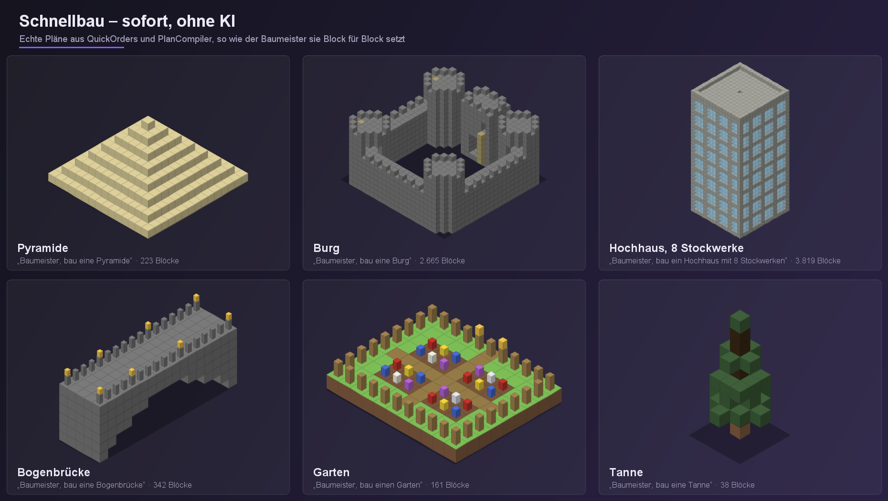
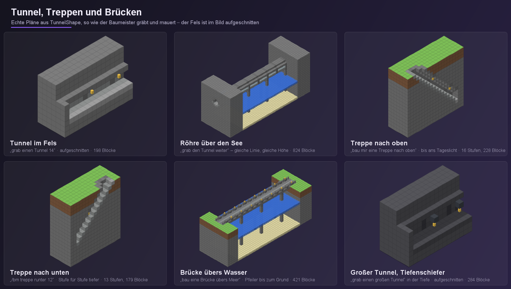
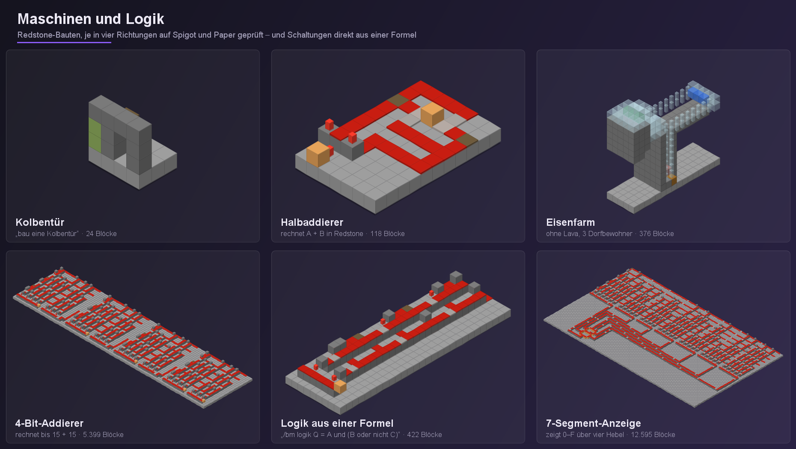
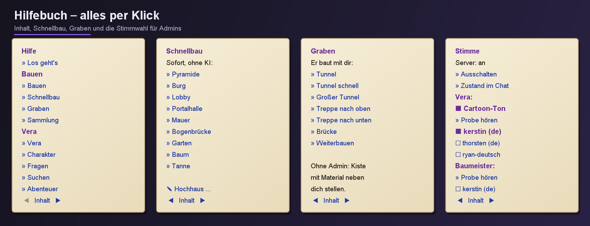

# Spielen mit dem Baumeister

**Was du sagen kannst, was er baut – und was er nicht tut.**

[In 30 Sekunden](#in-30-sekunden) · [Bauen lassen](#bauen-lassen) · [Schnellbau](#schnellbau-ohne-ki) ·
[Tunnel](#tunnel-treppen-und-brücken) · [Maschinen](#maschinen-farmen-und-schaltungen) · [Vera](#vera) ·
[Wenn etwas schiefgeht](#wenn-etwas-schiefgeht) · [Für alle](#für-alle-spieler) · [Fragen](#häufige-fragen)

Diese Seite ist für Spieler auf einem Server mit dem Baumeister. Wer den Server betreibt, findet Einrichtung und Rechte
in der [Installation](installation.md) und alle Einzelheiten im [Handbuch](handbuch.md).

## In 30 Sekunden

1. Schau dorthin, wo gebaut werden soll.
2. Schreib in den Chat: **„Baumeister, bau mir eine Burg“**.
3. Der Baumeister fliegt hin und setzt Block für Block. Gefällt es dir nicht: **`/bm rückgängig`**.

Alles geht auch per Klick: **`/hilfe`** öffnet das Hilfebuch, jede Zeile darin ist ein Knopf.

## Bauen lassen

- **Ansprechen:** im Chat „Baumeister, …“ oder „@Baumeister …“ – oder als Befehl `/bm bau <auftrag>`.
- **Wo:** vor dir, in deiner Blickrichtung. Vorher ansehen: `/bm vorschau <auftrag>` zeigt den Umriss aus Partikeln,
  „ja“ baut, „nein“ verwirft.
- **Wie:** Was nicht aus dem Schnellbau kommt, plant eine KI – das Plugin prüft den Plan und setzt nur, was du selbst
  setzen dürftest. Läuft gerade keine KI, sagt er es; Schnellbau, Tunnel und Schematics gehen trotzdem.
- **Mehrere Aufträge** stellt er hintereinander: `/bm warteschlange` zeigt sie, `warteschlange abbrechen` nimmt deine
  heraus. Wie weit er ist: `/bm fortschritt`.
- **Am selben Bau weiter:** „mach das Dach rot“, „noch ein Stockwerk drauf“ – er merkt sich deinen letzten Bau eine
  Stunde lang, solange du in der Nähe bleibst. „Baumeister, vergiss das“ macht den nächsten Auftrag wieder zum Neubau.

| Sag zum Baumeister | Was entsteht |
|---|---|
| „bau mir ein kleines Haus aus Fichtenholz“ | Haus nach deinen Wünschen, von der KI geplant |
| „bau eine Burg“, „bau eine Pyramide“ | Schnellbau, sofort, ohne KI |
| „bau ein Hochhaus mit 8 Stockwerken“ | Hochhaus mit Fensterbändern |
| „bau eine Eisenfarm“ | geprüfte Farm, danach sagt er dir, was du noch tun musst |
| „grab mit mir einen Tunnel“, „bau mir eine Treppe nach oben“, „bau eine Brücke übers Meer“ | Tunnel, Treppe, Brücke – [siehe unten](#tunnel-treppen-und-brücken) |
| „schneller“, „langsamer“ | laufender Bau im Schnellgang bzw. wieder Block für Block |
| „… mit 4 Helfern“, „mehr Helfer“ | Helfer-NPCs bauen mit |

## Schnellbau ohne KI

Diese Bauwerke kennt er auswendig und baut sie sofort: **Pyramide, Burg, Hochhaus, Bogenbrücke, Garten, Baum,
Tanne, Mauer, Lobby, Portalhalle, Bunker** und **acht Farmen**. Die Liste mit Knöpfen steht im Hilfebuch unter
„Schnellbau“. „bau eine Brücke“ baut die lange Brücke mit Pfeilern – sie steht unten bei Tunnel und Treppen.

## Tunnel, Treppen und Brücken

| Sag | Was passiert |
|---|---|
| „grab mit mir einen Tunnel“, `/bm tunnel` | Er gräbt vor dir her, solange du mitgehst – „stopp“ beendet. |
| „grab einen Tunnel, 40 Blöcke“ · „… schnell“ | 40 Blöcke allein, Block für Block · im Schnellgang in Sekunden |
| „grab einen Tunnel 5000 Blöcke schnell“ | schnurgerade, über Täler und Seen als Röhre mit Fenstern |
| „… großen“ · „… kleinen“ · „… nach Norden“ | 5 × 4 bzw. 1 × 2 statt 3 × 3, andere Richtung |
| „grab einen Tunnel durch den Berg“ | endet, wo er ins Freie bricht |
| „bau mir eine Treppe nach oben“, `/bm treppe` | Treppe bis ans Tageslicht – im Tunnel zur Seitenwand geschaut: durch die Wand |
| „bau eine Treppe nach unten“, `/bm treppe runter` · „… 20 Stufen“ · „… bis y -40“ | Treppe hinab |
| „bau eine Brücke übers Meer“, `/bm brücke` | Brücke auf deiner Höhe, Pfeiler bis zum Grund |
| „grab den Tunnel weiter“, „bau die Brücke weiter“ | erkennt, was dasteht, und baut im selben Stil weiter |

**Was er nicht tut:** Er gräbt nur durch Natur – Stein, Erde, Erz, Kies, Wasser, Lava. Steht Gebautes im Weg (Bretter,
Fackeln, Schienen), hört er davor auf und sagt, wo. Grundstücke anderer Spieler bleiben unangetastet, und einen
Spieler mauert er nie ein.

**Material:** Admins und Spieler im Kreativmodus bauen frei. Alle anderen stellen eine Kiste mit Bausteinen, Treppen
und Laternen neben sich – was darin liegt, bestimmt das Aussehen. Was er abgräbt, kommt in die Kiste oder in volle
Fässer in der Tunnelwand. Alle anderen Bauten kosten nichts.

## Maschinen, Farmen und Schaltungen

- „bau eine Kolbentür“, „bau eine Eisenfarm“ – geprüfte Maschinen und Farmen, in jede Himmelsrichtung.
- `/bm katalog [suchwort]` – Hunderte Schematics zum Durchklicken, ein Klick baut.
- Vera hilft bei eigenen Schaltungen: „Vera, prüf meine Schaltung“ findet den Fehler, „reparier meine Schaltung“
  baut die sicheren Fehler um, „was macht diese Schaltung?“ probiert alle Hebel durch.
- Admins bauen Schaltungen aus einer Formel: `/bm logik Q = A und (B oder nicht C)`.

## Vera

Vera ist deine Begleiterin: Sie folgt dir, findet ihren Weg durch Höhlen und über Treppen, redet mit dir und hilft.
`/vera` ruft sie, `/vera <satz>` wirkt wie „Vera, <satz>“ im Chat.

| Sag zu Vera | Was passiert |
|---|---|
| „wo finde ich Diamanten?“ | sie zeigt dir den Weg zum Erz |
| „bring mich zur Farmwelt“, „nach Hause“ | Reise zu Warps und gemerkten Orten |
| „crafte mir 4 Fackeln“ | craftet aus **deinem** Inventar, nur mit deinen Zutaten |
| „mach die Tür auf“, „leg den Hebel um“ | sie läuft hin und benutzt es |
| „sei frech“, „sei wieder nett“ | anderer Charakter |
| „Vera, lass uns Minecraft spielen“ | Abenteuer bis zum Enderdrachen, Etappe für Etappe |
| „kannst du das hier reparieren?“ | Baumeister-Bau, Redstone oder Creeper-Schaden |

Mit dem Mod **Simple Voice Chat** hörst du Vera sprechen und kannst ihr antworten – wenn der Server es eingerichtet
hat. Welche Mods du brauchst, sagt dir `/mods`. Die meisten Sätze versteht sie auch, wenn gerade keine KI läuft.

## Wenn etwas schiefgeht

| Problem | Was hilft |
|---|---|
| Er baut gerade das Falsche | „stopp“ oder `/bm stop` – hält sofort an, auch zwischen zwei Tunnelstücken |
| Es gefällt dir nicht | `/bm rückgängig` nimmt deinen letzten Bau zurück, mehrmals hintereinander auch die davor – der Server merkt sich 50 Bauten, auch über Neustarts. Was du inzwischen selbst dort gebaut hast, bleibt stehen. |
| Er baut nicht | `/bm status` zeigt, ob er beschäftigt ist und ob die KI erreichbar ist. Oft fehlt das Recht am Ort (Grundstück, Schutzgebiet). |
| Er hört vor etwas auf | Dort steht Gebautes oder Grundgestein – er sagt dir die Stelle. |
| Ihm fehlt Material | Er wartet und sagt, was fehlt; leg es in die Kiste neben dir. |
| Etwas ist kaputt, und Rückgängig reicht nicht mehr | Sag es einem Admin – Betreiber können Schäden wiederherstellen ([Handbuch](handbuch.md#komfort)). |

## Für alle Spieler

| Befehl | Was es ist |
|---|---|
| `/hilfe` | Hilfebuch – alles per Klick, Kapitel nur mit Recht |
| `/rucksack` | Rucksack mit 100 Seiten, Sortieren und Teamkisten |
| `/warp` | Warps zu den Orten des Servers |
| `/aufgaben` | Tagesaufgaben |
| `/mods` | welche Minecraft-Fassung und welche Mods du brauchst, mit Download |
| `/bm karte` | Minikarte in die Hand: Straßen, Baustellen, Wegpunkte |

## Häufige Fragen

**Brauche ich Mods?** Nein – ein normaler Minecraft-Client reicht. Für Veras Stimme brauchst du Simple Voice Chat,
`/mods` sagt dir, wie.

**Kostet das etwas?** Normale Bauten nicht. Tunnel, Treppen und Brücken bezahlst du aus einer Kiste, außer du bist
Admin oder im Kreativmodus.

**Warum baut er nicht auf meinem Nachbargrundstück?** Weil du dort selbst nicht bauen dürftest. Er prüft jeden Block in
deinem Namen – was du nicht setzen dürftest, setzt er auch nicht.

**Kann er etwas kaputt machen?** Er baut nur dort, wo du darfst, und fast jeder Bau ist rückgängig zu machen – nur
ein Tunnel aus der Kiste nicht, denn das Abgebaute liegt dann schon bei dir. Gegraben wird nur durch Natur.

**Was geht noch nicht?** Die ehrliche Liste steht im [README](../README.md#was-geht-was-noch-nicht).
