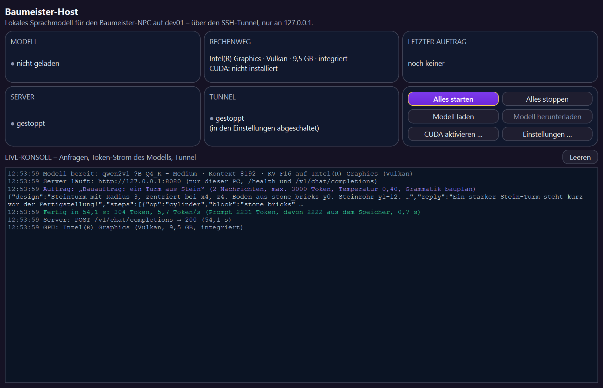

<div align="center">


# StreamWizard Baumeister-Host

**Das Sprachmodell für den Baumeister-NPC – auf der eigenen Grafikkarte, ein Klick, kein Java, kein PowerShell.**


[Schnellstart](#schnellstart) · [Was die App tut](#was-die-app-tut) · [Sicherheit](#sicherheit) · [Bauen](#bauen) · [Stand](#stand)

</div>



<sub>Konsolenzeilen wörtlich aus der Messung vom 2026-10-28 (Laptop, Intel-Arc-iGPU, 7B), erzeugt mit `BaumeisterHost.exe --screenshot`.</sub>

Der Baumeister (Paper-/Spigot-Plugin auf deinem Minecraft-Server) fragt für jeden Bauauftrag ein lokales LLM nach
einem Bauplan. Ein Spieleserver hat meist keine passende Grafikkarte – das Modell läuft deshalb auf einem PC mit
Grafikkarte und wird über einen SSH-Rückwärtstunnel erreicht. Läuft der Minecraft-Server auf demselben PC, geht es
auch ohne Tunnel (127.0.0.1:18080). Der Baumeister-Host ersetzt dafür `llm-host/start-llm.ps1` (llama-server + plink in PowerShell) durch
**eine** Windows-App.

## Schnellstart

Auf dem GPU-PC (NVIDIA, 12 GB VRAM empfohlen):

1. Den Ordner `minecraft` auf den PC kopieren.
2. **`host\einrichten.cmd` doppelklicken.** Das Skript installiert, was fehlt (PowerShell 7, Git, Build Tools,
   CMake, Vulkan-SDK, Inno Setup, Qt aus obs-deps mit Prüfsummen, PuTTY), baut die App (ohne Tests) und startet das Setup.
   Der erste Bau dauert rund 10–20 Minuten.
3. **BaumeisterHost starten**, in der Tunnel-Karte auf **„Server eintragen …“** klicken, „Der Server läuft auf
   einem anderen Rechner“ wählen und **Server-Adresse** und **Benutzer** eintragen (läuft der Minecraft-Server auf
   diesem PC: „auf diesem PC“, dann gibt es keinen Tunnel). Anmeldung mit **Pageant** (Schlüssel, empfohlen) oder Passwort;
   einmal mit PuTTY zum Server verbinden (Hostschlüssel bestätigen) oder den Fingerabdruck eintragen.
4. **„Verbinden“** startet Server und Tunnel – das reicht für Stadt- und Weltbau, die ohne KI laufen (die App zeigt
   dann ihren Fortschritt). **„KI einschalten“** lädt zusätzlich das Modell (Qwen2.5 14B, 8,4 GB, SHA-256 geprüft) auf
   die GPU – nötig für Bauaufträge im Chat (`/bm status` zeigt „erreichbar“). Was beim Programmstart passiert, steht
   in den Einstellungen unter „Start“.

Schneller rechnen auf NVIDIA: **„CUDA aktivieren …“** – lädt den CUDA-Kern (≈ 540 MB) nach Zustimmung zur NVIDIA-Lizenz.
Ohne Zustimmung rechnet Vulkan, auch auf der NVIDIA-Karte.

## Was die App tut

| Teil | Aufgabe |
|---|---|
| Modell | llama.cpp im eigenen Prozess, alle Schichten auf der GPU (Vulkan oder CUDA), KV-Speicher wiederverwendet: der System-Prompt wird nur beim ersten Auftrag gerechnet |
| Server | `http://127.0.0.1:8080` – `GET /health`, `POST /v1/chat/completions` im Format von llama-server (das Plugin bleibt unverändert) |
| Turbo | Spekulatives Dekodieren: Qwen2.5 0.5B rät Token voraus, das große Modell prüft mehrere in einem Durchgang – gleiches Ergebnis, auf dedizierten GPUs schneller; die App misst beim Laden, ob es lohnt |
| Grammatik | Bei `response_format.json_schema.name == "bauplan"` erzwingt `src/plan/bauplan.gbnf` gültige Pläne (keine unbekannte `op`, keine fremden Felder) |
| Tunnel | `plink -batch -v -N -R 127.0.0.1:18080:127.0.0.1:8080 root@<server>` (Schlüssel aus Pageant oder Passwort, DPAPI-verschlüsselt, über `-pwfile`), Neustart nach 10 → 60 s, erkennt „Pageant fehlt/0 Schlüssel“, „Port belegt“, „Hostschlüssel unbekannt“ |
| Stadt | Reiter neben der Plan-Vorschau: Stadt- und Weltbau als Karte (Weltbau mit Kachelraster, früheren Kacheln und Spielern, `docs/weltbauansicht.png`), gemeldet vom Plugin über `POST /baumeister/v1/stadt` (Draufsicht je Etappe, Fortschritt je Sekunde) – siehe `docs/stadtansicht.png` |
| Lokaler Server | zusätzlich `http://127.0.0.1:18080` für einen Minecraft-Server auf diesem PC (Plugin-Vorgabe `llm.url`, ohne Tunnel); abschaltbar in den Einstellungen |
| Live-Konsole | jede Anfrage, der Token-Strom des Modells beim Schreiben, Dauer, Token/s, Tunnel-Ereignisse; Warnung, wenn ein Auftrag weit unter dem eigenen Tempo lag |
| Verlauf | Reiter neben Plan und Stadt: letzte 50 Aufträge mit Tempo und dem Ergebnis im Spiel, das das Plugin meldet (`POST /baumeister/v1/ergebnis`) – gebaut, verworfen, abgesagt |
| Recherche | Schalter „Internet-Recherche erlauben“: Das Plugin fragt vor jeder Wikipedia/Wikidata-Abfrage `GET /baumeister/v1/recherche` und meldet, was es nachgeschlagen hat (Konsole, Karte „Letzter Auftrag“) |
| Modellwahl | Auswahl direkt in der Modell-Karte – mit Grafikspeicher je Modell; Wählen lädt um, eine fehlende Datei wird nach Rückfrage heruntergeladen. Ohne eigene Wahl nimmt die App beim ersten Start das größte Qwen2.5, das auf die Karte passt |
| Begleiter | Liest die Antworten des Begleiters im Spiel vor (Windows-Sprachausgabe, deutsche Stimme wie Hedda/Katja), nur für den in den Einstellungen eingetragenen Minecraft-Namen – `POST /baumeister/v1/begleiter/sagen`; erkannte Sprache holt das Plugin über `GET /baumeister/v1/begleiter/gehoert` ab |
| Sprechen | Taste halten (Vorgabe hintere Maus-Seitentaste, auch V, B, F8 …), sprechen, loslassen: Mikrofon (WinMM, nur während die Taste gedrückt ist) → whisper.cpp v1.9.4 auf derselben GPU und demselben ggml wie das Sprachmodell → Text an den Begleiter. Einschalten in den Einstellungen; das Erkennungsmodell (Whisper Large v3 Turbo q5, 574 MB, SHA-256 geprüft) lädt die App dann einmalig |
| Im Spiel | Mit Simple Voice Chat: `POST /baumeister/v1/begleiter/hoeren` erkennt Ton aus dem Spiel (eigener Spieler immer, Mitspieler nur mit „Andere Spieler verstehen“, Vorgabe an); meldet das Plugin beim Abholen (`?imspiel=`), dass du im Voice-Chat bist, ruht die Sprechtaste der App, `POST /baumeister/v1/begleiter/stimme` liefert Veras Antwort als 48-kHz-Ton fürs Spiel |
| Stimme | Piper wie in kraken (Vorgabe Thorsten medium, natürlich; lädt einmalig ~85 MB von github.com/huggingface.co, SHA-256 geprüft, läuft als eigener Prozess), Windows-Stimme als Rückfall |
| Mikrofon | Karte „Begleiter“: Zustand, Pegel, zuletzt gehört, „Mikrofon testen“ (4 s aufnehmen, vorspielen, erkennen). Einstellungen: Halten oder Umschalten (endet bei Stille), Verstärkung von Hand, automatische Verstärkung auf −20 dBFS, Signaltöne |
| Infobereich | Schließen legt die App in den Infobereich; beendet wird über Rechtsklick → Beenden |

Daten: `%LOCALAPPDATA%\StreamWizard\Baumeister` (Modelle bleiben bei Neubau, Neuinstallation und Deinstallation erhalten; vom anderen PC kopierte GGUF-Dateien prüft die App und übernimmt sie ohne Download) (`config.local.json`, `models\`, `components\`, `logs\`).

## Modelle

| Modell | Grafikspeicher (geschätzt, mindestens Kontext 8192; „Automatisch“ nimmt mehr, wenn frei) | Download | Hinweis |
|---|---|---|---|
Vorgabe ist das Qwen2.5 14B als Q3_K_M: Es passt samt 1,5 GiB Puffer neben Minecraft ganz auf eine 12-GB-Karte
(gemessen 2026-11-04: Q4_K_M lag dort zu 7 von 48 Schichten auf der CPU, ~9 Token/s). Alle anderen Modelle bleiben
wählbar.

| Modell | Grafikspeicher (geschätzt, Kontext 8192; „Automatisch“ nimmt mehr, wenn frei) | Download | Hinweis |
|---|---|---|---|
| Qwen2.5 14B Instruct, Q3_K_M | 8,7 GB | 7,3 GB | **Vorgabe**, passt neben Minecraft |
| Qwen2.5 14B Instruct, Q4_K_M | 10,4 GB | 9,0 GB | beste Qualität, ohne Spiel auf derselben Karte |
| Mistral Nemo 12B Instruct | 9,4 GB | 7,5 GB | ungemessen |
| Qwen3.8 9B (Destillat) | 7,2 GB | 5,8 GB | neuere Architektur, **unzensiert** – Antworttext landet im Chat |
| Llama 3.1 8B Instruct | 6,5 GB | 4,9 GB | ungemessen, Llama-3.1-Lizenz |
| Qwen2.5 7B Instruct | 5,7 GB | 4,7 GB | für 8-GB-Karten; plant Anbauten schwächer |
| Qwen2.5 Coder 14B/7B/3B/1.5B | 10,4 / 5,7 / 2,8 / 1,8 GB | 9,0 / 4,7 / 1,9 / 1,0 GB | Code-Modelle, für Baupläne ungemessen; 1.5B ist die Basis von `tools/train` |
| Phi-3.5 mini, Llama 3.2 3B | 6,2 / 3,5 GB | 2,4 / 2,0 GB | klein, ungemessen |
| Qwen2.5 3B Instruct | 2,8 GB | 1,9 GB | für kleine Karten, nur private Nutzung (Qwen-Research-Lizenz) |
| eigene GGUF-Datei | – | – | z. B. ein selbst trainiertes Modell (`tools/train`), ohne festgelegte Prüfsumme |

Kleine Modelle (1.5B, 3B) verwechselten im Spiel Geben und Suchen (Log 2026-11-04) – für Vera das 14B nehmen.

## Sicherheit

- Server nur an `127.0.0.1` (`SO_EXCLUSIVEADDRUSE`), Tunnel auf dem Server nur an Loopback – kein offener Port im LAN.
- Host-Kopf muss `127.0.0.1`/`localhost`/`[::1]` sein (DNS-Rebinding), Anfragen mit `Origin` oder `Sec-Fetch-Site`
  → 403 (Browser), POST nur `application/json`.
- Body ≤ 256 KiB, Kopf ≤ 16 KiB, `Content-Length` Pflicht, kein `Transfer-Encoding`, ein Auftrag gleichzeitig (503).
- plink nur über absoluten Pfad, Ziel/Ports/Fingerabdruck streng geprüft, Kind im Job-Objekt (endet mit der App).
- Modelle und CUDA nur mit festgenagelten Prüfsummen aus `deps.lock.json`; DLL-Suche gehärtet; startet nicht erhöht.

## Bauen

```bash
pwsh -File host\build.ps1
```

Liegt der Ordner tief (z. B. entpacktes Zip in `Downloads`), baut `build.ps1` von selbst in einem kurzen Ordner unter
`%LOCALAPPDATA%\BaumeisterBau` – sonst scheitert MSVC an der Windows-Pfadgrenze. Programm und Setup bleiben in `host\out`.

Stages `configure, build, stage, installer` – **Tests nur mit `-Tests`** (auf dem GPU-PC sperrt Smart App Control
frisch gebaute Test-EXEs; ohne den Schalter entstehen keine). Einzeln z. B. `-Stage build,test`. Ergebnis:
`host\out\installer\StreamWizard-Baumeister-Host-Setup-<ver>.exe` samt `.sha256`. Werkzeuge siehe `deps.lock.json`;
auf einem frischen Rechner richtet `einrichten.ps1` sie ein.

GPU-Probe mit echtem Modell: `pwsh -File host\build.ps1 -Stage test -GpuTestModel <datei.gguf>` (Label `gpu`).

## Stand

- ✅ Bau, Unit-Tests (HTTP-Parser, Host/Origin-Abwehr mit Gegenprobe, Grammatik gegen `plan-schema.json` und die
  Prompt-Beispiele, Katalog, plink-Argumente, Einstellungen), Setup
- ✅ Gemessen auf dem Laptop (Intel Arc, Vulkan, integrierte GPU nur für den Test) mit `LlmProbe`
- ⏳ CUDA und NVIDIA-Karte: hier nicht prüfbar (keine Karte) – auf dem GPU-PC prüfen
- ⏳ 14B-Download und Ende-zu-Ende über den Tunnel mit `/bm status`
- ⏳ Setup nicht signiert
